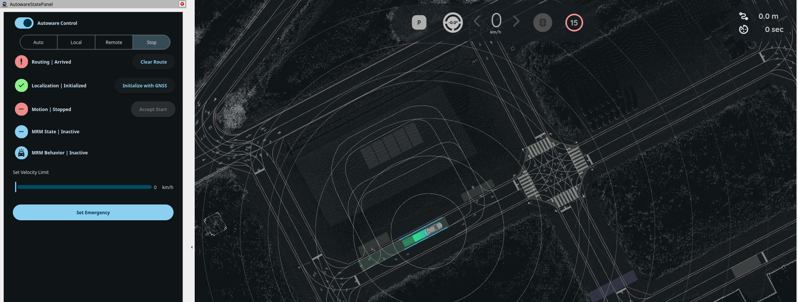

# Developing Autoware with Bazel

This guide describes day-to-day development after Bazel has been adopted across
the project. During staged adoption, it applies only to packages and targets
that already have Bazel support. It is not an adoption or migration guide. To
add Bazel to an unsupported Autoware area, follow PLAN.md and the chronological
milestones and experiments in JOURNAL.md.

## Prerequisites

Use Ubuntu 24.04 x86_64 and install Bazelisk as `bazel`. The repository's
`.bazelversion` selects the tested Bazel release. Bazel supplies the ROS and C++
build dependencies; do not source a host ROS installation for Bazel commands.
Do not satisfy target dependencies with apt, pip, rosdep, or the repository's
Ansible roles. Declare them in the Bazel graph. Platform kernel drivers and the
minimal host tools needed to launch Bazel are host prerequisites, not target
dependencies.

Put machine-specific limits in the ignored `user.bazelrc`, for example:

```text
build --jobs=6
build --local_resources=cpu=6
```

Choose limits appropriate to the machine and run heavy builds sequentially.

## Daily build, test, and run loop

Run Bazel from the repository root in a clean caller environment:

```bash
env -i HOME="$HOME" PATH="$HOME/.local/bin:/usr/bin:/bin" \
  bazel build //path/to/package:target
```

Build the narrowest useful target while iterating. Before committing, build the
package or runnable slice affected by the change.

Run its tests with:

```bash
env -i HOME="$HOME" PATH="$HOME/.local/bin:/usr/bin:/bin" \
  bazel test //path/to/package:target_test
```

Use `--nocache_test_results` when the validation requires proof that a test
executed during the current task:

```bash
env -i HOME="$HOME" PATH="$HOME/.local/bin:/usr/bin:/bin" \
  bazel test --nocache_test_results //path/to/package:target_test
```

Run an executable and pass application arguments after `--`:

```bash
env -i HOME="$HOME" PATH="$HOME/.local/bin:/usr/bin:/bin" \
  bazel run //path/to/package:node -- --ros-args
```

A successful build proves compilation and linking only. Use `bazel test` for
test behavior and `bazel run` for an end-to-end node or system check.

## Middleware configurations

Cyclone DDS is the default development middleware. No custom Cyclone DDS XML is
needed for local loopback communication. Add network configuration only for a
topology that demonstrates the need.

Fast DDS is the Tier 2 compatibility configuration. Routine validation uses
Cyclone DDS. Run Fast DDS checks only at major milestones after obtaining the
user's explicit approval for the check. After approval, add `--config=fastdds` to
the same build, test, or run command at the compatibility gate:

```bash
env -i HOME="$HOME" PATH="$HOME/.local/bin:/usr/bin:/bin" \
  bazel test --config=fastdds //path/to/package:target_test
```

Do not let a Fast DDS-only workaround determine the primary Cyclone DDS path.

## Agnocast runtime tests

Agnocast support is compiled into supported wrappers unconditionally.
`--config=no-agnocast` selects their RCLCPP backend at runtime. Verify the
complete wrapper C++ suite with both runtime selections:

```bash
env -i HOME="$HOME" PATH="$HOME/.local/bin:/usr/bin:/bin" \
  bazel test --config=no-agnocast --nocache_test_results \
  @autoware_agnocast_wrapper//...
env -i HOME="$HOME" PATH="$HOME/.local/bin:/usr/bin:/bin" \
  bazel test --strategy=TestRunner=local \
  --run_under=//bazel/agnocast:with_heaphook \
  --test_env=ENABLE_AGNOCAST=1 --nocache_test_results \
  @autoware_agnocast_wrapper//:unit_tests
env -i HOME="$HOME" PATH="$HOME/.local/bin:/usr/bin:/bin" \
  bazel test @autoware_agnocast_wrapper//:launch_tests
```

The enabled command builds the heap hook and preloads it from declared
runfiles using repository mapping. The component owns its Cargo setup in
`@agnocast_heaphook`; run allocator unit tests separately with
`bazel test @agnocast_heaphook//:unit_tests`, without production preload.
The enabled command requires a compatible Agnocast kernel module already loaded
and an accessible `/dev/agnocast`. Use local TestRunner execution because Agnocast
shares PID-named objects in the host `/dev/shm`; reused sandbox PIDs can collide.
Compile actions remain sandboxed. Check the GTest log for all 37 C++ cases and the pytest log for all 66
launch-action cases passing with no skips. Do not preload Python test drivers. Run Fast DDS variants only after approval at a major milestone.

## Interface declarations and bridge plugins

BUILD declarations define the interfaces supported by Bazel. Register an
interface and its dependencies explicitly when a consumer needs it. Undeclared
source files remain outside the build graph. An all-interface collection is
the declared dependency closure of its selected product roots.

Interface identities use package/kind/Name, where kind is msg, srv or action
from the source extension. Nested source categories such as msg/object_recognition/
do not add a ROS namespace; consumers use the generated package/msg headers.

Maintain the top-level selection in `bazel/interfaces/BUILD.bazel`. Each
`ros_interface_package(cc, shared, roots = ...)` entry pairs the package's
explicit C++ and shared-provider targets once. Its default selection is the
whole `cc` interface closure; supply `roots` to select individual interfaces.
An explicit roots list remains a fixed subset when other interfaces are added
to the package. Expand that list or select the whole provider when the product
starts consuming more of the package.
For example:

```starlark
ros_interface_package(
    "@your_interfaces//:cc",
    "@your_interfaces//:cc_shared",
    roots = ["@your_interfaces//msg:YourMessage"],
)
```

`ros_interface_set(packages = [...])` combines those entries. Its optional
`roots` override can select application targets; collection follows their
declared `deps`, not actual C++ type usage. The corresponding package providers
must still be declared explicitly. No labels are guessed from interface names.

`//bazel/interfaces:all_interfaces` exposes the metadata closure, merged
`CcInfo`, shared-library provider and runtime files. A compiled consumer can
use that target in both `deps` and `dynamic_deps`; a metadata-only consumer can
read `RosInterfaceSetInfo`. Agnocast declares only `interface_set` on its plugin
macro and supplies its own Agnocast/RCLCPP dependencies internally. Package
registration belongs only in the central selection, not the plugin BUILD file.
The collection has no Agnocast dependency. The plugin rule iterates the interface
provider during analysis and uses native `expand_template` actions to produce
typed C++ factories under that target's output directory, then compiles and
links `libagnocast_bridge_plugins.so` in the same graph. It reuses the upstream
C++ templates and helpers without invoking the ROS verb, a Python renderer,
or a generated CMake package. On Lyrical, each service also gets a pub/sub
plugin for its synthesized `<Service>_Event` message, using the service header.
It accepts message and service interfaces; action bridges are unsupported.
Interface discovery does not use `AMENT_PREFIX_PATH`.

Python/introspection consumers use `//bazel/interfaces:all_interfaces_python`.
The same package entries supply generated Python bindings and resource indexes;
there is no second package list. Ordinary `:cc` providers default to sibling
`:py` and `:ament_index` targets. Supply `python` and `index` explicitly for
nonstandard providers, as for grid_map. These are package-wide providers even
when metadata roots select fewer types. Declared interface dependencies forward
their indexes transitively, so nested message definitions remain discoverable.
This optional projection does not add Python dependencies to C++ consumers.

Test the plugin library with the kernel module available:

```bash
env -i HOME="$HOME" PATH="$HOME/.local/bin:/usr/bin:/bin" \
  bazel test --strategy=TestRunner=local \
  --run_under=//bazel/agnocast:with_runtime --nocache_test_results \
  //bazel/agnocast:bridge_plugins_test
```

After approval, add `--config=fastdds` for a major-milestone compatibility gate.
The test uses the production BridgeLoader to select the declared
shared library and checks payloads in
both directions for standard/local messages, a service, and its event message.
Publisher peers run in separate processes because bridge subscriptions ignore local
publications. Add returned bridge callback groups to the mixed executor
explicitly; the factories create them with automatic registration disabled.
Run the complete template naming checks with
`bazel test //bazel/agnocast:template_tests`.
Run `bazel test @agnocastlib//... --local_test_jobs=1` without a global
preload. The five mocked unit groups and mocked executor integration stay
unpreloaded; kernel integration groups use their own component-owned heap-hook
launchers, and allocator integration supplies its mock before the hook.
Inspect explicit upstream skips in the test XML instead of treating a green
target as coverage for unsupported behavior.

The root runtime index composes the plugin library, heap hook, discovery agent,
configurator and component resources. Keep these payloads in test/application
`data`, not a `--run_under` tool's data, to preserve target RMW selection.
`with_runtime` sets resource and library paths before final-process startup;
Python launch tests use `launch_suite.py` to apply preload only after Python's
bootstrap. Use explicit nonempty `export_name` values on root ament indexes.
Component modules register executable aliases under `lib/<package>` using
`register_ament_files`, so launch and automatic agent startup find them.

Run all seven functional launch targets, the communication matrices and service
arrangements with the same runtime wrapper and `--local_test_jobs=1`. The
matrix targets are `//bazel/agnocast:matrix_1to1` (128 QoS/order/transport
configurations) and `//bazel/agnocast:matrix_2to2` (three modes × eight process
layouts); `//bazel/agnocast:launch_services` covers nine arrangements. Matrix
logs, immutable configuration copies and per-case JUnit reports are retained
under each target's `test.outputs` directory. They do not edit source YAML or
invoke the upstream colcon shell runners.

Keep Python extension metadata consistent with setup.py/setup.cfg. Build and
run `//bazel/agnocast:ros2` for the product's CLI/runtime closure; package-level
`@ros2agnocast//:ros2` supplies the extensions without the product resource
assembly.

## Source and package layout

Source snapshots under `src/` are ordinary tracked files imported as squashed
git subtrees. Edit them in place. Do not run `vcs import` or `vcs pull` into
`src/`.

Keep:

- workspace-wide Bazel support under `bazel/`;
- package-owned `MODULE.bazel` and BUILD files beside package source;
- original upstream tests in their existing package directories;
- all newly added tests, adapters and fixtures under `bazel/tests/<package>/`;
- root-level integration test targets and verification archives under `bazel/tests/`;
- runnable product composition, launchers and runtime configuration under `bazel/runtime/`;
- native bundles, OCI/OSTree assembly, install layouts and service definitions under `bazel/deployments/`;
- only the optional builder bootstrap recipe, `dev.Dockerfile`, under `images/`;
- integration strategy and evidence under `docs/bazel/`.

Deployment targets consume the product's declared runtime closure; maintain
one selection of application resources. Runtime products and source components
must not depend on deployment formats or test targets. Tests may consume both
products and deployment artifacts, with their verification companions marked
testonly. Reusable SDK/build support stays with its third-party owner.

Interface collection and product plugin assembly belong under `bazel/`.
Assemble interface sets with `//bazel/interfaces:interfaces.bzl`; bridges,
loggers, and other root-module consumers can share the same provider. A
separate autoware_bazel source repository is deferred until a concrete need
justifies it. Components export their own inputs and never depend back on
metarepository paths. The workspace owns release selection and local
overrides; resolve rule-owned labels in their defining module.

Do not extend `repositories/`, `docker/`, or `ansible/` for Bazel work; they are
reference implementations for the existing build and deployment.

## Dependency conventions

### Repository dependency layers

| Location | Owns | May depend on |
| --- | --- | --- |
| bazel/ | Product composition, interface collections and standalone integration tests | src/ component modules, assets/ resource providers and third_party/ providers |
| src/ | Component-specific source/build definitions and original upstream tests | Other component modules, public asset modules and reusable third-party providers |
| assets/ | Deployment-selectable resource inputs, metadata and resource indexes | Generic registry/build providers; no application or product targets |
| third_party/ | Independent SDK/dependency definitions, generic runtime/test helpers and dependency patches | Registry/toolchain dependencies and other reusable providers |

With arrows meaning "supplies inputs to", the layers are
(BCR/RCR + third_party/) -> src/ -> bazel/, plus assets/ -> src/ and bazel/.
Asset modules/resource packages use the `_asset` suffix. A component may declare
a logical asset-module dependency and consume its public index; keep physical
asset paths/revision selection in root overrides, with no component-to-root labels.
See the [asset convention and deployment sketch](../../assets/README.md).

The root owns version selection from third_party/, registry releases and local
overrides. Consumers use logical module targets, not paths into their parent's
bazel/ directory. Root selects the CUDA fragment from
third_party/cuda/cuda.MODULE.bazel and the local TensorRT module from
third_party/tensorrt; .bazelrc keeps product/compiler/architecture selection.
Reusable pins and compatibility support live with the dependency they describe;
this does not transfer product selection to components or SDK consumers.
TensorRT is a standalone module; CUDA remains a root-included configuration
fragment with reusable build/patch support, without an artificial facade module.
Generic SDK test launchers belong with the SDK; Autoware-specific integration
adapters and fixtures remain under bazel/tests/.

### Recursive discovery and IDE targets

The root .bazelignore excludes src/, assets/ and standalone third-party module
directories from the main repository's recursive package discovery. Those
directories are consumed through local_path_override and their logical module
labels. Keep this list updated when adding a standalone module outside the
already excluded src/ and assets/ trees; keep metarepository-owned third-party
helpers available under their normal //third_party/... labels.

Do not load the same standalone BUILD through its physical parent-repository
path. For example, use @spconv//:spconv or @spconv//..., rather than
//third_party/spconv:spconv. The latter applies the root repository mapping to
module-owned .bzl loads, so dependencies declared only by spconv can appear
missing. Adding private SDK dependencies to the root does not correct that
repository boundary.

For IDE integration, select the runnable/library targets being developed and
their dependency closure, or explicitly include the relevant @module//...
roots. Root //... discovers metarepository packages; it does not enumerate
external modules, including local overrides. Excluding a physical directory
from root discovery leaves its module targets available. These are Bazel label
conventions; configure the IDE's target selection accordingly.
See Bazel's [target patterns](https://bazel.build/run/build#specifying-build-targets)
and [.bazelignore](https://bazel.build/run/bazelrc#bazelignore) documentation.

### Dependency declarations

Group root MODULE.bazel declarations by ownership: BCR/RCR and Conda inputs,
third_party providers, core sources, Universe sources, launcher sources, then
root Bazel product configuration. Keep asset, model and sensor resource
providers between third_party and core sources. Put SDK includes with
third_party and product includes with bazel at the end. Within each group,
place prerequisites before consumers where possible. This layout does not
change Bazel's dependency resolution. Each local
`bazel_dep` omits its version and is immediately followed by its matching
`local_path_override`:

```starlark
bazel_dep(name = "autoware_vehicle_msgs")
local_path_override(
    module_name = "autoware_vehicle_msgs",
    path = "src/core/autoware_msgs/autoware_vehicle_msgs",
)
```

The override selects the local module for every dependent, including those
requesting published versions. Bazel bypasses registry metadata and source
lookup for that module. An invalid local path fails without registry fallback.
Every independent consumer root must supply its own overrides. Bazel ignores
overrides declared by dependency modules and does not discover local checkouts.
See [Bazel's non-registry overrides](https://bazel.build/external/module#non-registry-overrides)
and [the documented versionless pair](https://bazel.build/external/migration#introduce-local-repositories).

Place other module overrides immediately below their matching `bazel_dep`,
with any rationale comment attached to the override. This includes registry
version and patch overrides. Keep overrides for transitive-only modules in a
separate labeled block. Do not add a direct dependency just to place an
override. Repository overrides through `override_repo` stay with their module
extension configuration.

`bazel/deployments/deployments.MODULE.bazel` is an included root-module fragment,
not a standalone module. It declares the pinned `@ubuntu_runtime` repository
used by OCI image targets. Keep its include at the end of the root manifest.
Moving the include does not change that repository's digest or the image rules.

Use the local source snapshot for every supported package present under src/.
Use the ROS Central Registry for dependencies absent from the source checkout.
A local Autoware package owns a package-local Bazel module. The root module
selects the local snapshot with `local_path_override`; version metadata lives in
the package-local module.
Package-local dependency versions remain `0.0.0`; the root selects registry
releases for external dependencies and source overrides for local ones.

For an external registry package that resolves to 0.0.0 without BUILD rules,
inspect registry metadata and published overlays before introducing a provider.
Pin a usable published release at root while keeping component requirements at
0.0.0; validate that dependency's original suites and its affected consumers.
The source-only placeholder is not evidence that every registry release lacks
support.

Removing a local override requires an explicitly requested source-selection
comparison and a compatible registry version. It is not part of the normal
developer loop. Add missing Bazel definitions when adopting a required local
package; absence of those definitions is not a reason to use registry sources.

When changing a registry/provider version, inspect its transitive build-rule
requirements as well as its source version. Avoid incidental upgrades of shared
rule/toolchain baselines; validate the accepted dependency and affected consumers.
Header-only providers must declare transitively included template files such as
.tcc/.ipp, alongside .h/.hpp files; export the complete upstream include tree
where appropriate.

For a C++ consumer using generated ROS libraries, pair compile and runtime
dependencies:

- depend on the generated package's `:cc` target;
- add its `:cc_shared` target to `collect_transitive_dynamic_deps`.

This preserves the RCR shared-library layout required at runtime.

NDT's kernel, node and C++ test consumers use the same SSE4.2 options on x86_64
because Eigen/SIMD settings affect their shared data layout. Keep those options
consistent when adding a direct C++ consumer. The OpenMP runtime is a Bazel-built
LLVM archive, imported by the package-local `:openmp_runtime` target; do not add
host `-lomp` search paths. Its kernel compiles with `-fopenmp`.

## Editing interface packages

To add a message or service to a supported package:

1. Add the `.msg` or `.srv` source and a matching `ros_message` or `ros_service`
   declaration in its interface directory's BUILD.bazel. Declare every
   referenced interface target in that rule's `deps`.
2. Add that target (for example, `//msg:NewMessage`) to the package-root
   `default_generators(deps = [...])` list. This registers it in the generated
   aggregate `:cc` target. Preserve existing entries.
3. For a newly referenced external package, update package.xml, MODULE.bazel,
   and `default_generators.dependencies` as appropriate.
4. Build the package's generated targets and affected consumers. If its `:cc`
   target is already a collector root, the new interface appears in
   `//bazel/interfaces:all_interfaces` through that dependency path. Build
   `//bazel/agnocast:plugins` to instantiate the expanded plugin set.

For example:

```bash
env -i HOME="$HOME" PATH="$HOME/.local/bin:/usr/bin:/bin" \
  bazel build @your_package//... //bazel/interfaces:all_interfaces \
  //bazel/agnocast:plugins
```

Mixed packages containing nodes and interfaces work the same way. When the
collector root is a node or library, the new interface must be reachable
through that target's `deps`. If a package is not reachable from any root,
add or update its central `ros_interface_package` entry, including the selected
roots and explicit compile/shared providers. The plugin consumer needs no
matching list update.
For a mixed package, select the generated providers directly, for example:

```starlark
ros_interface_package(
    "@autoware_planning_validator//:cc",
    "@autoware_planning_validator//:cc_shared",
)
```

The package's node/plugin library remains a separate target. Its generated
interfaces, owned package index and implementation may share one Bazel module;
collecting the generated provider does not require linking the node into the
bridge. Register service-only providers too, such as the AD API version service.
The descriptor test checks canonical identities and selected supported types;
it does not check source-directory completeness or discover undeclared files.

Keep collection roots independent of the plugin library to avoid a cycle.
An interface source that is not registered remains outside the Bazel build.

When changing a `.msg` or `.srv` file, keep three dependency declarations
consistent:

1. retain manifest-level package dependencies in the package-local
   `MODULE.bazel`;
2. list every directly referenced interface target in the individual
   `ros_message` or `ros_service` rule;
3. list every package referenced by generated types in
   `default_generators.dependencies`.

Do not add a manifest-only dependency to generator inputs when no current
interface references it.

For a registered interface provider, keep a product-owned serialization check
under `bazel/tests/<package>/BUILD.bazel`:

```starlark
load("//bazel/tests/ros_interfaces:defs.bzl", "interface_serialization_test")

interface_serialization_test(package = "your_package")
```

Run `bazel test --config=runtime --config=no-agnocast
//bazel/tests/your_package:all` alongside affected native consumers. The helper
round-trips the generated public message types and service Request/Response/Event
types through native CDR support. Preserve package-specific payload tests too;
default-value round trips do not establish nondefault payload or service behavior.
This check does not inspect undeclared source files or enforce registration.

Build the complete generator surface, not only a C++ consumer:

```bash
env -i HOME="$HOME" PATH="$HOME/.local/bin:/usr/bin:/bin" \
  bazel build @autoware_package_name//...
```

Then run a consumer that constructs or transports the changed type. At an
approved major milestone, repeat the bounded build and consumer test with
`--config=fastdds`.

## Editing C++ utility packages

Build and test a locally selected package through its external-repository
label, which exercises the same module boundary used by its consumers:

```bash
env -i HOME="$HOME" PATH="$HOME/.local/bin:/usr/bin:/bin" \
  bazel test --nocache_test_results @autoware_utils_math//...
```

Package-owned tests must declare their test framework as a normal direct module
dependency. Bzlmod ignores `dev_dependency` declarations in a module when that
module is consumed from the root workspace, including through a
`local_path_override`.

For C++ tests that do not supply their own main, depend on
`@googletest//:gtest_main`. Use `@googletest//:gtest` when the existing test
sources already define main.

A `cc_library` declares the RCR compile target, such as
`@rclcpp//:rclcpp_library`, in `deps`. Put the corresponding shared-library
target, such as `@rclcpp//:rclcpp`, in the `collect_transitive_dynamic_deps`
closure of each final `cc_binary` or `cc_test`. The library rule itself does not
accept `dynamic_deps`.

Apply the same pairing to generated services and directly used C libraries.
For example, compile logging utilities with `@logging_demo//:cc` and
`@rcutils//:rcutils_library`, then include `:cc_shared` and `:rcutils` in the
final executable's dynamic dependency closure. Declare dependencies referenced
by a public header directly even when another library also brings them into the
transitive graph.

Use a ROS dependency version of `0.0.0` in a package-local module only when the
root graph also selects a concrete release. A standalone `0.0.0` RCR module can
be a source-only compatibility stub with no BUILD overlay. If analysis reports
that the external repository has no BUILD package, inspect the resolved module
and pin the matching concrete RCR release at the root rather than inventing
labels for the stub.

When a header-only library sits above a local compiled library, its final
executables must still collect the shared ROS closure needed by that compiled
library. Static `cc_library` propagation supplies compile and link inputs, but
does not replace the RCR `cc_shared_library` runtime providers.

For Boost headers already mapped by the pinned rosdistro, use its narrow target
rather than adding the BCR umbrella module. For example, UUID consumers use
`@rosdistro//cc:boost.uuid`.

Package resources accessed through ament_index_cpp or ament_index_python need
an `ament_index` target from `@rosdistro//ament:defs.bzl`, with `package_xml`
and the required resources in `data`. Add that index to the consuming test or
binary's runtime `data`; it supports package-share lookup from runfiles without
sourcing a host ROS installation. For example, run the vehicle calculator with
its default indexed YAML:

```bash
env -i HOME="$HOME" PATH="$HOME/.local/bin:/usr/bin:/bin" \
  bazel run @autoware_vehicle_info_utils//:min_turning_radius_calculator
```

Geography consumers can use `@autoware_geography_utils//:runtime_dynamic_deps`
for its shared-library closure and `:geoid_grid` as a declared data file. Set
GEOGRAPHICLIB_GEOID_PATH to the grid's runfiles directory in the consuming
process when EGM2008 is selected. Do not rely on an apt-installed geoid dataset.
The geography suite runs both grid-present and deliberately grid-absent cases;
the GNSS suites run against the real grid without skipping height conversion:

```bash
env -i HOME="$HOME" PATH="$HOME/.local/bin:/usr/bin:/bin" \
  bazel test --nocache_test_results @autoware_geography_utils//...
env -i HOME="$HOME" PATH="$HOME/.local/bin:/usr/bin:/bin" \
  bazel test --config=no-agnocast --nocache_test_results @autoware_gnss_poser//...
```

Ordinary RCLCPP component behavior tests need no Agnocast preload or bridge.
For root Python consumers of generated messages, set LD_LIBRARY_PATH=lib on
the py_test so transitive C introspection libraries resolve from the declared
runfiles prefix at process startup. Keep component resources and shared
libraries in data through its ament_index. For example:

```bash
env -i HOME="$HOME" PATH="$HOME/.local/bin:/usr/bin:/bin" \
  bazel test --nocache_test_results --strategy=TestRunner=local \
  //bazel/tests:crop_box_filter_test
```

Tests using the compiled helpers or parser from autoware_test_utils declare
`@autoware_test_utils` in deps and `@autoware_test_utils//:runtime_dynamic_deps`
in dynamic_deps. Add its `:ament_index` to data for config, parser fixtures and
map URI resolution; do not use checkout-relative resource paths. Its optional
visualization header is not currently exported by these compiled-helper targets.
Use a test fixture to own ROS init/shutdown when the source has no custom main,
so context cleanup also runs after failed assertions.

## Generated parameter libraries

For an already-supported package using generate_parameter_library, load its
macro from `@generate_parameter_library//:defs.bzl`, pass the original parameter
schema as yaml_file, and depend on the generated target from the component.
The macro emits include/<package>/<target>.hpp using a Bazel execution tool.
Keep parameter defaults, validation and runtime configuration in the original
schema/config files; do not check in a manually generated replacement header.
Consumers using its runtime helpers include the generator package's rsl and
rclcpp_lifecycle shared providers in their dynamic dependency closure.

## Native ROS component nodes

For a component deriving directly from rclcpp::Node, use
`rclcpp_components_register_node` from `@rclcpp_components//:defs.bzl`. Supply
its shared component and plugin, and set `node_name` to generate the executable.
Register `<name>_record` in the package's ament_index and install the executable
through register_ament_files. Keep package-specific shared-library names so
libraries from multiple components can coexist in a runtime prefix.

Python integration peers need their C message type-support libraries available
to dlopen as well as their generated Python modules. Declare the package
ament_index in the consuming Python program's data and its integration test
data. Check that their runfiles expose the exercised shared
libraries. Set the test's `LD_LIBRARY_PATH` to `lib`; `--run_env` settings
alone do not configure a native py_test environment. Native ROS-only nodes do
not interpret ENABLE_AGNOCAST as a backend switch.

When a launch starts an RCR component container, declare its executable-bearing
runtime provider. For the selected RCR, @rclcpp_components//:ament_package
supplies component_container_mt and its libexec layout; :ament_index contains
only test component metadata. A package exporting such a launch should compose
the runtime provider in its resource closure, so consumers need no host ROS.

## Switchable standalone nodes

Tests of wrapper endpoints must dispatch callbacks with the selected backend's
executor. Agnocast dispatches in spin(), not inherited RCLCPP spin_some(). For
bounded tests, spin asynchronously, cancel and join before inspecting received
data or destroying endpoints, and synchronize callback-written state.


For a wrapper-derived node using AgnocastOnlyCallbackIsolatedExecutor and a
SingleThreadedExecutor fallback, load `autoware_agnocast_node` from
`@autoware_agnocast_wrapper//:defs.bzl`. Supply the shared component, plugin class,
package name and executable name. The ROS fallback defaults to SingleThreadedExecutor;
set `ros2_executor = "MultiThreadedExecutor"` when the component needs callbacks
in separate groups to progress during a blocking service operation. Match the
component's existing executor contract. Add its `<name>_components` and `<name>_plugin`
records to the package's ament_index; register the executable under lib/<package>
with register_ament_files. For a component deriving from rclcpp::Node, set
`agnocast_only = False` to select CallbackIsolatedAgnocastExecutor and its
get_node_base_interface contract; do not cast it to wrapper::Node. Other
executor pairs need explicit support before use.

For a component requiring an SDK-aware native launcher, pass its binary factory
as `binary_rule`, for example `binary_rule = tensorrt_cc_binary`. The factory
must accept `name`, `srcs`, `data`, `deps` and `dynamic_deps`. The wrapper still
owns the generated main, executor selection and plugin records. Declare the SDK
in the component module; keep it out of the generic wrapper module.

Keep added behavior sources and fixtures under bazel/tests/<package>/. Root
targets select product runtime dependencies; package BUILD files expose original
upstream suites without introducing component-to-root labels.
Run ordinary RCLCPP fixture suites with --config=no-agnocast. Standalone
behavior targets explicitly select and verify their native child's backend:

```bash
env -i HOME="$HOME" PATH="$HOME/.local/bin:/usr/bin:/bin" \
  bazel test --nocache_test_results --test_output=errors \
  --local_test_jobs=1 --strategy=TestRunner=local \
  --run_under=//bazel/agnocast:with_runtime \
  //bazel/tests:vehicle_velocity_converter_agnocast_test
```

The enabled child needs /dev/agnocast, the declared heap hook and root bridge
runtime; the Python peer stays unpreloaded. The matching `_rclcpp_test` target
selects the RCLCPP backend. Check unittest logs for case totals; the acceleration
targets each run two cases while Bazel's fallback XML records one invocation.

## Embedded Python and plotting tests

Build native embedding code against `@rules_python//python/cc:current_py_cc_headers`
and `:current_py_cc_libs`. Use `@autoware_pyplot` for the C++ plotting API and
`@autoware_test_utils//:visualization` for its optional plotting helpers.

Run the original suites with the root runtime launcher:

```bash
bazel test --local_test_jobs=1 --nocache_test_results --test_output=errors \
  --run_under=//bazel/tests:with_python \
  @autoware_pyplot//... @autoware_trajectory//... @autoware_route_handler//...
```

The launcher supplies Bazel's Python and wheel paths, pinned GNU wheel runtimes,
headless Agg rendering and a writable font cache. Its Linux extension-loader
configuration isolates wheel symbols from the native LLVM C++ runtime. Figures
are retained in each test's undeclared outputs; GTest writes the normal XML
report. Keep PLOT enabled and trajectory's ENABLE_TEST_PLOT=1 setting. The original
route-handler suite includes one upstream-disabled case, reported separately.

For the learning-based vehicle connector, InterconnectedModel owns its Python
interpreter. Create the model before using Python APIs, and do not wrap it in a
second scoped_interpreter. Python-owned submodels must be released before
interpreter shutdown. Run its root integration fixture with the same launcher:

```sh
bazel test --config=runtime --config=no-agnocast --nocache_test_results \
  --run_under=//bazel/tests:with_python \
  //bazel/tests/autoware_learning_based_vehicle_model:embedding_test
```

## Simulation primitives

The simulator, dummy perception and door simulator expose their original native
executables and launch/parameter resources through package-owned ament indexes.
Run each module's complete original suite and its root launch gate together:

```sh
bazel test --config=runtime --config=no-agnocast --local_test_jobs=1 \
  --nocache_test_results --test_output=errors \
  @autoware_simple_planning_simulator//... \
  @autoware_dummy_perception_publisher//... @autoware_vehicle_door_simulator//... \
  //bazel/tests/autoware_simple_planning_simulator:launch_test \
  //bazel/tests/autoware_dummy_perception_publisher:launch_test \
  //bazel/tests/autoware_vehicle_door_simulator:launch_test
```

Use the separate embedded-Python command above for the learning connector.
When including simple_planning_simulator.launch.py, supply its caller-owned
initial_engage_state, motion_publish_mode and vehicle_model_pkg configurations,
and the vehicle_info_param_file from the selected indexed description. Keep
these choices in launch composition. The primitive fixture uses the core
sample description; original AWF workflow adoption belongs to the
[simulator milestone](PLAN.md#awf-planning-simulator-milestone).

## Editing Python and launch packages

Declare the Python library's complete source set and direct runtime imports in
its package-local BUILD file. Reuse RCR Python targets and its pinned pip hub;
do not install dependencies with host pip. Keep generated ROS Python interfaces
as namespace packages: the workspace disables implicit initializer creation
across the graph, because an empty transitive __init__.py can hide generated
message imports.

Keep CLI/launch extension metadata in the runfiles dependency closure and
consistent with setup.py or setup.cfg. Adding a Python class alone does not
register a command or frontend extension. The Agnocast CLI builds its metadata
from setup.py; the wrapper carries its frontend registration as explicit BUILD
data and supplies setup.cfg to its install metadata.

Run each package's complete Python suite, for example
`bazel test @ros2agnocast//:tests` or
`bazel test @autoware_agnocast_wrapper//:launch_tests`. Check the pytest summary
in test.log for case totals; the current RCR pytest launcher leaves Bazel a
single fallback XML case for the invocation. Package resource metadata does
not replace a Python provider dependency such as `@agnocast_cie_config_msgs//:py`.
For recording/schema consumers, also include each selected package's
`:ament_index` in runtime data. Local `rosidl_ament_package` declarations depend
on their own generator's `:ament_index` to retain generated IDL and resource
markers. Python imports alone do not provide message definitions to rosbag.

Use `bazel run //bazel/agnocast:ros2 -- agnocast version` for the composed CLI.
Verify discovery, echo and recorded schema/payload with:

```bash
bazel test --strategy=TestRunner=local \
  --run_under=//bazel/agnocast:with_runtime \
  --nocache_test_results --test_output=errors //bazel/agnocast:cli_runtime_test
```


Python launch drivers must start without the allocator preload. Apply it after
interpreter startup to the launched native processes, as the root launch
adapter does. Preserve the host PID namespace for kernel-backed launches and
run configurator/socket tests sequentially so they do not compete for their
well-known Unix-domain socket.

## Development image

The optional base image provides bootstrap tools for running Bazel builds.
Source, Bazel-managed dependencies and application outputs are supplied or
created when the container runs. Keep deployment-image rules under
bazel/deployments/; images/dev.Dockerfile is the only file under images/.
Do not maintain an image containing a prebuilt workspace or populated Bazel
cache. A source mount and persistent cache volume support normal incremental
development; an offline/prepared image needs a separate concrete requirement.

Build the development image when its definition changes:

```bash
docker build -f images/dev.Dockerfile -t autoware-bazel-dev:bootstrap .
```

The Dockerfile pins its Ubuntu base and Bazelisk version, but its bootstrap apt
packages come from live repositories. Record the built image digest when an
exact bootstrap environment must be preserved. Target dependencies remain
selected by Bazel; this image does not replace their pins or host kernel/device
prerequisites.

Use a named cache volume and mount the source read-only for build validation.
Use a writable source mount when editing inside the container. Disable
convenience symlinks for a read-only workspace:

```bash
docker volume create autoware-bazel-bootstrap-cache
docker run --rm \
  -v autoware-bazel-bootstrap-cache:/home/ubuntu/.cache \
  -v "$PWD:/workspace:ro" \
  autoware-bazel-dev:bootstrap \
  bazel test --experimental_convenience_symlinks=ignore \
  --nocache_test_results //path/to/package:target_test
```

Fast DDS compatibility checks require explicit approval before adding
`--config=fastdds` to the Bazel command.

## Dependency patches

Keep dependency patches with their owner under `third_party/<dependency>/`
(optionally in a `patches/` subdirectory) and apply them through a pinned module
or repository override. Before the diff in each patch file, document the affected
module/version and target, observed failure, why the change fixes it, its scope,
verification commands/results or their journal reference, and upstream status
or tracking reference. Update this preface when the patch or its validation
changes. Verify that Bazel can still apply the documented patch.

## Expensive targets

Costly system checks and distribution assembly are disabled by default. Enable
them explicitly with --config=expensive, then select only the targets needed
for the current change. The configuration unlocks targets; it does not schedule
an entire suite or change the middleware.

The opt-in covers native application/verification archives and their dependent
OCI/OSTree artifacts and checks, plus the original Universe simulator launch
suite. Ordinary package tests and runnable products such as
//bazel/runtime:planning_simulator remain available without this configuration.
Wildcard builds/tests skip disabled targets. Explicitly requesting a disabled
target reports an incompatible-target error; enable the configuration to run it.
Disabled or skipped tests do not count as passing a required completion gate.

Use affected package builds/tests for routine development. Run the relevant
expensive gate when changing product composition, runtime resources, packaging
layout, service supervision, export rules or a gate's behavior, or when an
explicit milestone requires it. Reuse passing results for unchanged inputs;
docs, labels or configuration-only changes can often use analysis with --nobuild
and focused lightweight checks. Identical artifact hashes can support reuse of
the existing runtime evidence. Full simulator driving and OCI export assembly
are not automatic follow-ups to every task or commit. Preserve complete module
acceptance whenever that module's behavior or runtime closure is affected.

For example, when simulator distribution behavior needs verification:

```sh
bazel test --config=expensive --config=runtime --config=no-agnocast \
  --local_test_jobs=1 --test_output=errors \
  //bazel/tests:planning_simulator_native_runtime_test
```

For an export-label change with unchanged assembly rules and payloads, analyze
the export without producing another large archive:

```sh
bazel build --config=expensive --config=runtime --config=no-agnocast --nobuild \
  //bazel/deployments:planning_simulator_oci
```

The shared --config=expensive sets //bazel:enable_expensive_targets=true.
An optional local default can be set in ignored user.bazelrc:

```text
# Enable only while working on costly system/deployment targets.
build --//bazel:enable_expensive_targets=true
```

Omit that override for normal development. Pass
--//bazel:enable_expensive_targets=false to disable it for an individual command.
Keep machine resource limits in user.bazelrc independently of this opt-in.
Fast DDS still requires separate explicit approval.

## Validation and commits

Probe runtime prerequisites (devices, drivers and permissions) from the same
execution environment used by the test. A device hidden from a restricted shell
may still be available to a host-side gate, and the reverse can also occur.

Retain upstream placeholder tests and add root-owned behavior checks when their
assertions do not observe the component. Placeholder success alone does not
establish plugin loading, valid outputs or clean shutdown.

Validate in proportion to the change:

- BUILD or module change: build affected target surfaces; label/selection-only
  changes can use analysis and focused checks when action inputs and runtime
  behavior are unchanged;
- interface definition or declaration change: build generated targets and test
  affected consumers;
- library change: build and run the affected module's complete test suite;
- executable or communication change: run a behavior check;
- builder bootstrap change: build the development image and validate an
  affected target with the source mounted read-only;
- deployment change: select the relevant artifact/behavior gates using the
  [expensive-target convention](#expensive-targets);
- documentation-only change: run targeted documentation checks and state that
  no runtime validation was performed.

Use Cyclone DDS routinely. Run the complete changed module suite and relevant
behavior checks; do not repeat the entire communication matrix for every
commit or phase. Reserve full system matrices for communication-layer changes
or explicitly scoped milestones, and run Fast DDS only with approval. Reuse
passing results when code and configuration are unchanged. Document the actual
scope; an interrupted sweep is not a passing sweep.

For feature-gated native dependency tests, preserve the original driver as well
as its executable. Check that required backends actually ran: an exit-zero
"unsupported" path does not satisfy the gate. Preserve driver contracts such as
argv[0], working directory, repetitions and fixture paths when adapting them to
runfiles. Keep generic adapters with the dependency owner.

For sensor-frame behavior, use a non-identity mounting transform. Check each
conversion direction against a known vector independently; two inverse mistakes
can cancel in a round trip. Preserve tf2's target/source lookup order even when
an older wrapper names its arguments from/to.

For ROS time-window behavior, cover the epoch and exact horizon/retention
boundaries. Preserve zero-based fixtures. Compare ages as signed Durations;
avoid creating negative absolute Time cutoffs while history is warming up.

Run only targeted format and static checks for files changed by the task. Do
not run pre-commit for this experiment.

Use signed-off Conventional Commits. Keep source compatibility changes in a
separate `fix(src/<repository>): ...` commit from Bazel build definitions. Do
not commit `user.bazelrc`, Bazel output trees, or convenience symlinks.

## Solver dependencies

The current OSQP/QP interfaces use the OSQP 0.6 API. Their osqp_legacy repository
alias selects BCR 0.6.3.bcr.3, while the root multiple_version_override preserves
RCR's OSQP 1.x selection for separate consumers. Keep the package-owned forwarding
headers for the osqp/ include namespace. Do not combine both ABIs in one process
without a separate compatibility design and validation. ProxQP uses the pinned
ProxSuite provider. Run each solver's full module suite after dependency changes;
for smoother runtime changes run both velocity_smoother backend tests under
//bazel/agnocast:with_runtime, with --config=no-agnocast for the RCLCPP target.
The enabled target requires the kernel module/device and built heap hook. See
[the solver/smoother experiment](JOURNAL.md#2026-11-17-phase-525--osqp-interface)
for input rationale, complete commands and coverage limits.

## Native plugin libraries

Keep the original plugin XML and its exported base-package category. Build a
cc_shared_library with shared_lib_name matching the XML library path, then
register it through ament_index(libraries=[...], plugin_categories={"plugins.xml":
"base_package"}). The map key is the XML label; the value is the package passed
to pluginlib::ClassLoader. Consumers declare the plugin package's :ament_index
as data so the XML, resource record and library are available in runfiles.
Do not add a component-to-root label or scan the host ament environment.

Give auxiliary shared libraries package-specific shared_lib_name values too.
Independent CUDA helpers named :gpu_preprocess must not both become
libgpu_preprocess.so: different Bazel repository labels do not give their ELF
SONAMEs different identities. Preserve the component project's library names
and inspect both SONAME and DT_NEEDED when composing native SDKs.

Provide package_xml: pluginlib reads the enclosing manifest to identify the
provider even when its XML/resource record is present. For test-only plugins,
expose a test-specific ament_index view with the original package.xml and required
runtime indexes. A test selects that view instead of the production view for
that package. Keep test plugin DSOs in data; prelinking them into a loader
executable changes factory ownership and does not prove runtime discovery.

Validate each factory through a real consumer, including discovery and clean
shutdown. For behavior planners, loading uses the fully-qualified plugin class;
unloading uses the module name (stop_line). Run
//bazel/tests:behavior_velocity_planner_standard_runtime_test and
//bazel/tests:behavior_velocity_planner_experimental_runtime_test with
--config=no-agnocast after changing their plugin assembly.
When a native component uses the broad `@autoware_utils` facade, include
`@autoware_utils//:runtime_dynamic_deps` in its dynamic-dependency aggregate.
Header-facing dependencies can still pull static SDK objects into a DSO;
PCL/conversions/VTK globals must remain in their existing shared owners.
Check actual ELF exports/dependencies and unload multiple components together;
a standalone process exiting once does not exercise cross-DSO ownership.

Give independent components separate runtime dependency providers. Image transport
constructs pluginlib loaders during library initialization, so image consumers
carry @image_transport//:ament_index_plugin in their indexed data. Visualization
consumers use :roi_runtime_dynamic_deps for the image component and
:map_runtime_dynamic_deps for the map component. This keeps each consumer's
shared libraries and runtime metadata aligned with its actual inputs.

Expose reusable plugin-package algorithms through a package-owned `cc_library`.
Have the plugin implementation and other components depend on that provider,
with shared SDK libraries supplied by the existing runtime dependency aggregate.
For example, `@autoware_behavior_velocity_intersection_module//:utils` owns
`src/util.cpp`; both the intersection plugin and roundabout consume it.
Factory registration remains in each package's plugin implementation.

Roundabout also indexes its original `ttc.py` plotting command. Use
`bazel run --config=runtime @autoware_behavior_velocity_roundabout_module//:ttc.py -- --help`
to inspect its arguments. Recording uses `--save` and flushes its GIF on
interruption. The GUI requires an accessible DISPLAY and XAUTHORITY. Validate
the registered command as its own process, including its startup environment,
message/resource closure and shutdown. Its complete gate is
`//bazel/tests/autoware_behavior_velocity_roundabout_module:all`; the plotting
test exercises real ROS inputs, recording and shutdown before any data arrives.

CPU filter consumers compile against
@autoware_pointcloud_preprocessor//:pointcloud_preprocessor_filter_base and link
through its :filter_base_runtime_dynamic_deps provider. Header-only consumers
can use :filter_base_headers. This preserves the original helper shared-library
boundary without depending on the complete filter-plugin DSO. The package owns
the helper, compiled utility roots and shared SDK delegation; products select
versions and compose consumers.

Consumers needing only point-cloud layout checks compile against
@autoware_pointcloud_preprocessor//:pointcloud_layout_library and link its
:pointcloud_layout shared owner. The filter-base provider re-exports this API
and delegates to the same owner. This keeps utility-only consumers independent
of filter components and their compiled geometry/math libraries.

Keep existing test helper sources in testonly libraries rather than linking
planning test managers into production components.

For dependency repositories containing several ROS packages, give each ament
index and interface declaration an explicit ROS package identity (`export_name`
and `package` in RCR rules). Keep original package/library names independent
of Bzlmod repository names. Publish a transitive dynamic-dependency provider for
native consumers of inline/plugin APIs; a raw shared-library target alone need
not link their direct references to its dependencies. See the
[grid-map provider conventions](../../third_party/grid_map/README.md).

The CPU laserscan occupancy target is
@autoware_probabilistic_occupancy_grid_map//:laserscan_based_occupancy_grid_map_node.
Its resource index declares the original launcher and static converter/container
providers. Run //bazel/tests/occupancy_grid:launch_test for original-launch
conversion/grid/shutdown checks. GPU pointcloud/fusion targets are not declared
by this CPU surface.


For the motion planner, the configured fully-qualified class name is also its
module name: use it for both load and unload. Run
//bazel/tests:motion_velocity_planner_runtime_test with --config=no-agnocast
after changing its obstacle-stop plugin assembly. Declare the real plugin index
on node tests that request it, alongside any intentionally unavailable plugin
names used to check error handling.

A plugin's parameter lifetime belongs to its hosting node. If that node supports
unload/reload, initialize parameters with read-or-declare semantics and preserve
current values. Verify a real reload after a parameter update; constructing a
plugin only once cannot expose repeated-declaration failures.

Keep plugin-private C++ types unique within the process, using a module namespace
or a distinct type name. Separate DSOs do not isolate incompatible definitions
with the same C++ identity: exported weak constructors/destructors can bind to
another plugin's layout. Validate selected factories together as well as alone.
For subprocess log capture, read a shared regular-file descriptor with os.pread;
seeking it also changes the child's write offset and can corrupt captured output.

## Launch resource composition

For file-only inspection, export the required XML/configuration files and
manifest from their owning source package with exports_files. A package-local
MODULE.bazel can expose that resource-only boundary without acquiring every
node referenced by its launch files. Consumers under bazel/ select logical
module labels and compose their fixtures there; avoid checkout-relative src/
paths in a metarepository filegroup. The root selects the local module override.
For example, @autoware_perception_launch currently exports only the YOLOX
launcher-check inputs. It has no runtime :ament_index target; adding that
target requires its selected runtime dependency closure and launch gate.

Keep ROS executable names stable even when Bazel target labels differ. Use
register_ament_files renames under lib/<package> to expose the names declared by
original launch files/CMake. Rootpath-based binary checks do not verify this
contract. Give component shared libraries package-qualified shared_lib_name
values: resource indexes share one lib directory, so generic physical names
can select a different package's factory. Existing launcher/component macros
consume the actual shared-library provider; preserve their stable target labels.

For a package containing real launch/config resources, expose them through
ament_index and compose its runtime dependencies' indexes through deps. Declare
vehicle/model parameter inputs at launch boundaries. Run the original XML
through launch_test, checking configuration/remaps and clean exits. Core planning
uses //bazel/tests:core_planning_launch_test; core control uses
//bazel/tests:core_control_launch_test and
//bazel/tests:core_control_gate_launch_test, all with --config=no-agnocast.

Before ending a composed launch test, poll each container's
composition_interfaces/srv/ListNodes service for the complete selected set.
A node can appear in graph discovery while its constructor is still running.
For standalone nodes, request a parameter response to establish executor
readiness, and provide real constructor dependencies such as map-loader
parameter services. Require clean exit codes from every launched process.

Dynamic launch arguments do not create Bazel dependency edges. The global
parameter loader resolves `<vehicle_model>_description` at runtime; keep that
loader independent of a particular vehicle. The application or test bundle must
explicitly include its selected description's `:ament_index` in runtime `data`
and select that module in its dependency graph. For example,
`vehicle_model=autoware_sample_vehicle` requires
`@autoware_sample_vehicle_description//:ament_index`. A root `bazel_dep` and
`local_path_override` select the local source, but the runtime data edge is what
makes its resources available to the launched process. Include all supported
model descriptions when a bundle permits choosing among several models.

Vehicle rendering uses `@autoware_core_vehicle//:ament_index` plus the selected
vehicle and sensor-description indexes in the caller's runtime data. That
index composes the robot-state-publisher runtime provider and the xacro index,
which publishes `bin/xacro` for the original launch command substitution.
Do not rely on a host-installed xacro. The sample and AWSIM description checks
are `//bazel/tests:vehicle_description_sample_launch_test` and
`//bazel/tests:vehicle_description_awsim_launch_test` with `--config=no-agnocast`.

Graphical consumers also exercise the platform driver's native ABI closure.
The declared graphics runtime pins GLVND/X11 and GNU libgcc/libstdc++ 14.2; the
runtime platform supplies the display and its compatible rendering driver.
Run //third_party/graphics_runtime:all with authenticated DISPLAY/XAUTHORITY when
changing that boundary. An EGL dispatch-only check does not prove that a Mesa
or vendor GLX driver can load and create RViz's visual.

## RViz plugin packages

Each supported plugin package owns its MODULE/BUILD declarations, original
plugin XML, icons/fonts/meshes and one indexed runtime. Build its implementation
with qt_cc_library and publish its original library filename through
qt_cc_shared_library. Use the selected Qt moc rules, explicit Q_OBJECT headers
and shared ROS/Qt/Ogre providers; preserve original QT_NO_KEYWORDS/visibility
flags. If moc headers share a basename, isolate their compilations in separate
qt_cc_library targets rather than renaming the source headers.

Keep compile providers and shared owners distinct. Collect concrete SDK dynamic
dependencies with collect_transitive_dynamic_deps and pass that aggregate to the
shared library. Consumers of Ogre's legacy UTFString ABI use the SDK-provided
char_traits_patch.h where required. Do not introduce a different character-traits
implementation or duplicate SDK globals across plugin libraries.

Register the original XML with ament_index(plugin_categories = {xml:
"rviz_common"}), the original package.xml, runtime resources and shared library.
Compose @rviz_common//:ament_index, and @rviz_default_plugins//:ament_index when
its SDK is used: the latter brings the indexed image/point-cloud transport
runtime as well. These runtime indexes avoid the unrelated build-tool exports
of SDK ament_package targets. The generic //third_party/rviz2:runtime adapter
publishes the RViz executable; product plugin selection belongs to
//bazel/runtime:planning_simulator_rviz. Components use logical SDK labels.

Add a package/XML pair to bazel/tests/rviz_plugins/BUILD.bazel when registering a
plugin. Its <package>_factories_test parses that original XML and constructs,
destroys and unloads every exported Display/Panel/Tool class. Run it with
--config=runtime --config=no-agnocast --local_test_jobs=1 --test_output=errors.
DISPLAY and XAUTHORITY must identify an accessible X11 session: some original
constructors query X11 directly even with Qt's offscreen platform. Factory
success does not replace the product's real rendering and interaction check.

## Universe planning simulator

The original simulator product uses sample_vehicle/sample_sensor_kit,
CPU/Cyclone DDS and Agnocast off. Run these commands from the repository root;
no host ROS environment needs to be sourced. Build first:

```sh
env -i HOME="$HOME" PATH="$HOME/.local/bin:/usr/bin:/bin" \
  bazel build --config=runtime --config=no-agnocast \
  //bazel/runtime:planning_simulator
```

Then launch the original RViz window, keeping waiting messages in a log:

```sh
env -i HOME="$HOME" PATH="$HOME/.local/bin:/usr/bin:/bin" \
  DISPLAY="$DISPLAY" XAUTHORITY="${XAUTHORITY:-}" \
  XDG_RUNTIME_DIR="${XDG_RUNTIME_DIR:-}" ROS_DOMAIN_ID=108 \
  bazel run --config=runtime --config=no-agnocast \
  //bazel/runtime:planning_simulator -- rviz:=true \
  > "${TMPDIR:-/tmp}/autoware-planning-simulator.log" 2>&1
```

Keep that terminal running. If no window appears, inspect the last 80 lines of
that log. The desktop must expose an authenticated X11/XWayland display and a
compatible OpenGL driver. The camera panel displays No Image in this simulated
rule-based profile. For manual lane driving:

1. Wait for the point-cloud/vector map and AutowareStatePanel to load.
2. Select **2D Pose Estimate**. Click a lane and drag along its direction;
   release and wait for Localization to become Initialized. For the first
   example, use the slanted straight road southwest of the central junction
   and drag northeast along it. The original
   adaptor fits the pose height to the indexed map.
3. Select **2D Goal Pose**. Click a reachable lane ahead, drag along the lane
   direction and release. Keep the first goal about 17 m ahead and before the
   junction. Wait for a route/trajectory and available **Auto**.
4. Click **Auto** in AutowareStatePanel. Observe the vehicle move and stop at
   its goal. Press **Ctrl+C in the launching terminal** to stop all nodes;
   the original launch can respawn RViz if only its window is closed.

The repeatable short scenario is recorded in
bazel/tests/planning_simulator_resources/scenario.yaml: start
(3717.2395, 73720.8438), goal (3732.0, 73728.6), heading about 28 degrees
counterclockwise from map +X, on lanelets 9102/9540. The typed equivalent is
//bazel/tests/universe_launch:lane_driving_test. It initializes through the
same /initialpose adaptor, sets a route through the public API, requests Auto,
and requires actual displacement, autonomous control, bounded arrival and stop.
The original GUI pose/goal/Auto workflow and this typed gate are validated.
Use **Clear Route** before selecting another route. The expected arrival state
is shown below; camera placement and mouse precision can differ.



For a headless session, use the same target with rviz:=false. The target supplies
original launch/config resources, real default rule-based planners/safety nodes,
native SDK runtime files and caller-selected sample model indexes. The map
resolves through autoware_map_asset; no map_path/data_path or absolute checkout
path is needed. Root planning_simulator_rviz composes the selected original
plugin indexes. The wrapper and YAML/XML frontends belong to the actual runnable
target's Python dependencies; test-only imports must not hide missing inputs.

The shared root configuration in bazel/runtime/cyclonedds.bzl sets
MaxAutoParticipantIndex=119. RMW's default of 32 is insufficient for this
single-host process graph. This controls discovery capacity, not kernel/network
provisioning or communication isolation. A different deployment topology must
select and validate its own domain/discovery configuration.

Run //bazel/tests/universe_launch:all with --config=expensive, the same build
configs and --local_test_jobs=1 --test_output=errors when changing this product
composition.
It exercises the original seven subsystem launches, full headless XML and the
closed-loop driving case. Component/standalone readiness, retained map/vehicle/
diagnostic resources, API version and clean shutdown remain part of the gate.
Routine component work keeps its own scoped suite. Existing core distribution
products retain their own scope; they do not package this simulator automatically.

## Native simulator distribution

Build //bazel/deployments:planning_simulator_bundle with --config=expensive
--config=runtime --config=no-agnocast. Extract its tar.gz at the desired installation prefix and
execute run_simulator from any working directory. It selects its own bundled
interpreter, libraries and indexed resources; no source checkout, Bazel command,
ROS setup script, Python installation or HOME model directory is a runtime input.
The supported native OS/ABI baseline still applies. The launcher defaults to the
headless original simulator; its subsequent arguments are original launch args.

The test-only //bazel/tests:planning_simulator_bundle_tests archive stays
separate. Use //bazel/tests:planning_simulator_bundle_structure_test and
//bazel/tests:planning_simulator_native_runtime_test for distribution changes.
They check closed archive links, extraction at another prefix, complete startup,
real lane driving and clean shutdown. The shared archive checker also retains
//bazel/tests:core_bundle_structure_test. These products package their declared
runfiles, not an inventory of files discovered on the builder's filesystem.

Independent-process test launchers must supply the product's explicit environment
at the exec boundary. In particular, do not forward a generated test PYTHONPATH
and rely on a child shell to unset it: a long relocated search path can prevent
that shell from starting. The product launcher then owns its own discovery paths.
The common Cyclone configuration is expanded into executable application/verifier
scripts from bazel/runtime/cyclonedds.bzl; update that source when the topology
requires another tested discovery profile.

## Python providers in runtime compositions

Use `runtime_python` from `//third_party/runtime:python.bzl` when a Python
consumer needs Python libraries reached through a non-Python product's runtime
graph. Set roots to the existing product target and add the resulting target
to the consumer's deps. The aspect collects PyInfo through deps, data, srcs,
libraries, executables, components and dynamic_deps; it merges the product's
runfiles and Python import/source providers. Ordinary data edges alone do not
propagate PyInfo to a py_binary. Keep runtime dependencies declared by their
owners rather than introducing a parallel package inventory.

Python plugin discovery also requires distribution metadata. The
`//third_party/ros2cli:entry_points` provider generates missing SDK CLI metadata
from the dependencies' own setup.py files using pinned setuptools. Add it to
the CLI's deps; keep entrypoint declarations and versions with those sources.
Its complete gate is `//third_party/ros2cli:metadata_test`. Generation runs in
an empty temporary directory with declared outputs, independently of checkout
package discovery or host Python installations.

The manifest output group records the selected roots and their declared runfile
symlink paths. It supports checking that a composed artifact preserves its
selected product's indexes/resources; it does not discover undeclared sources
or validate directory completeness. Run the generic helper's complete suite:

```sh
bazel test --config=runtime --config=no-agnocast \
  //third_party/runtime:runtime_python_test
```

## Sourceable native debugging environment

Build a debugging distribution from the planning_simulator entrypoint's
declared runtime closure, the existing all_interfaces selection and the selected
RCR ROS CLI extensions:

```sh
bazel build --config=expensive --config=runtime --config=no-agnocast \
  //bazel/deployments:planning_simulator_debug_bundle
mkdir -p /tmp/autoware-debug
tar -xzf bazel-bin/bazel/deployments/planning_simulator_debug_bundle.tar.gz \
  -C /tmp/autoware-debug
source /tmp/autoware-debug/install.bash
ros2 pkg prefix autoware_launch
ros2 pkg executables rclcpp_components
ros2 interface show autoware_planning_msgs/msg/Trajectory
python3 -c 'from autoware_planning_msgs.msg import Trajectory; print(Trajectory())'
```

setup.bash and its install.bash alias activate this distribution's bin directory,
ament prefix, native libraries, ROS Lyrical and CPU/Cyclone DDS profile with
Agnocast disabled. Activation replaces inherited ROS/Python discovery paths;
use a separate shell for another ROS installation. ROS_DOMAIN_ID, display
settings and an explicitly selected CYCLONEDDS_URI remain caller-owned. Match
ROS_DOMAIN_ID and discovery/network settings to the processes being inspected.
Use ros2 node/topic/service/param commands normally. The python3 wrapper selects
the same bundled interpreter and Python dependency environment as the CLI.
Runfiles variables remain private to each wrapper's subprocess so sourcing the
environment does not impose this tree on unrelated Bazel executables.

The product's indexes supply registered binaries, components, shared libraries,
interfaces, configuration, map/vehicle assets and RViz resources. Python
providers are collected from that product. The same top-level interface
selection used by compiled consumers supplies its Python/index projection;
compiled message libraries alone do not expose Python bindings or schema indexes.
Include the CLI group among the runtime_python roots too: its data edges can
carry Python providers that ordinary py_library deps do not forward. CLI
extensions add their own runtime dependencies. Undeclared
source packages and compiler/header/CMake SDK exports are outside this runtime
distribution. Add missing runtime exports to their owning package/index and
update the product's dependencies when its supported functionality changes.

Tools that spawn ros2 commands need the declared CLI and its extensions on
PATH as well as their Python imports. Supply them through the selected product's
sourceable environment; include the tool's package index in that product too.
For the in-lane MRM recorder/analyzer, expose the original commands as indexed
executables and retain the reusable rosbag_common Python provider. The gate
//bazel/tests/autoware_in_lane_mrm_planner:rosbag_tools_test supplies a pinned
ros2cli/ros2bag entrypoint, records actual DDS samples and checks generated CSV/PNG
reports. Use that behavior check after changes to the command line, dependencies
or plotting startup. --help or imports alone do not qualify recording/analysis.

The pinned RCR also provides ament_package and ament_underlay from
`@rosdistro//ament:defs.bzl`. They describe conventional installed package trees
and generate setup scripts/environment hooks. Use them when exporting that
package-install contract. The underlay aspect collects AmentPackageInfo through
deps; it does not consume an arbitrary entrypoint's data/runfile closure.
Our components currently export ament_index runtime providers, and some registry
ament_package declarations include build/lint/test dependencies. This debug
distribution therefore reuses the existing runtime indexes and RCR CLI Python
libraries, with a small shared activation template rather than substituting a
different package-install closure. The core run and run_simulator launchers source generated
instances of the same template before executing their fixed launch profiles.

Run the focused gates when changing this environment or its packaged closure:

```sh
bazel test --config=runtime --config=no-agnocast \
  //third_party/runtime:runtime_python_test \
  //bazel/tests/runtime_debug:launchers_test
bazel test --config=expensive --config=runtime --config=no-agnocast \
  --test_output=errors //bazel/tests/runtime_debug:bundle_test
```

The bundle gate extracts to a path containing spaces, checks preservation of
the entrypoint's declared index/resource paths, activates from a clean shell,
imports every interface in the declared all_interfaces selection and exercises
the CLI against a small live
peer. It does not start the full simulator or export an OCI image; select those
costly gates only when their behavior is affected.

## OCI simulator distribution

The simulator image puts the native application bundle at /opt/autoware over
the root-selected Ubuntu 24.04 base. Its headless entrypoint is run_simulator,
running as UID/GID 1000 with SIGINT for orderly shutdown. Build the OCI layout
or load the same manifest into the local Docker daemon:

```sh
bazel build --config=expensive --config=runtime --config=no-agnocast \
  //bazel/deployments:planning_simulator_oci //bazel/deployments:planning_simulator_docker_archive
bazel run --config=expensive --config=runtime --config=no-agnocast //bazel/deployments:planning_simulator_load
docker run --rm --name autoware-planning-simulator --pull=never \
  --network=none --read-only --cap-drop=ALL --security-opt=no-new-privileges \
  --tmpfs /tmp:rw,exec,nosuid,nodev \
  docker.io/library/autoware-planning-simulator:bazel
```

Stop it from another terminal with
docker stop --time 30 autoware-planning-simulator. The indexed map, model
descriptions, parameters, interpreter and libraries are application inputs;
no workspace/cache mounts, installed ROS/Python or dependency-install step is
needed. The local tag is a convenience, not an immutable release identifier.
Use the generated image manifest digest for release identity. The supported
runtime remains Linux x86_64/Ubuntu 24.04, CPU/Cyclone DDS with Agnocast off.
GUI display/device forwarding is not part of this image's acceptance gate;
use the native RViz instructions above for graphical lane driving.

For image changes, run the uncached local Docker gate:

```sh
bazel test --config=expensive --config=runtime --config=no-agnocast --local_test_jobs=1 \
  --test_output=errors //bazel/tests:planning_simulator_oci_runtime_test
```

It uses the separate verification companion, checks all three original
startup/driving/shutdown cases in an isolated read-only image, and then checks
startup and SIGINT shutdown through the normal image entrypoint. Keep the
verifier outside the application image. Run the native archive/closure gates
above as well when changing the shared application payload.

## Original test source layout

Keep original tests in their source packages and expose their inputs through
package-local rules. When a suite assumes sibling source directories, a root
adapter may stage declared runfiles into a temporary directory with the original
package names. Do not resolve that assumption through undeclared checkout paths
or accept dependency-related skips. Supply real generator executables through
runtime data/arguments. The interface-lint suite uses
`//bazel/tests:interface_spec_lint_tests`; it includes all original cases and
its committed-spec/manifest checks. Its original config determines active gates.

For an unchanged C++ test that loads sibling resources through `__FILE__`, declare
those files as test data. External-module compile paths start with `external/`,
whereas their runfiles repository is a sibling of the main runfiles repository.
A test-only `copts = ["-fmacro-prefix-map=external/=../"]` preserves that lookup
without editing the original test or using an undeclared checkout path. Restrict
the mapping to tests that require it; indexed-resource lookups remain preferable
for new tests.

When CMake supplies a test main, keep that driver and link gtest rather than
adding another gtest_main. Give the driver or fixture ownership of ROS context
initialization/shutdown; test bodies reuse an active context. If the original
suite itself initializes an active context twice, reproduce the failure and
correct the redundant call without dropping assertions or test files.

If another backend needs a different test initializer, retain the original driver
for its existing backend. Expose the unchanged test CPP through a test-only
textual_hdrs provider and include it in an adapter under bazel/tests, renaming
only its main. The adapter owns backend initialization/shutdown and runs every
original fixture/assertion. Supply only the adapter as the compiled test source;
the included CPP remains a textual input. The concatenator backend driver uses
this pattern to run the original wrapper suite without initializing RCLCPP on
Agnocast-only.

For a C++ fixture-path macro, derive its value from a declared $(rootpath file)
input and the expected parent directories. Keep quoted C++ strings intact
through copts tokenization; do not embed checkout paths or canonical repository
names. Declare runtime class-loader resource indexes as well as fixture bytes.
For components loaded into a separate container process, carry dependency indexes
in the component's own ament_index; a direct C++ test's data edges do not reach
that process. Use ament_package when a launch needs a dependency's installed
executable, rather than only its resource index.

For point-cloud consumers requiring native struct layouts, preserve padding in
fixtures with pcl::toPCLPointCloud2(cloud, message, true) before conversion to ROS,
and check point_step against sizeof(PointT). The ROS conversion convenience API
can remove padding; matching field names alone does not satisfy native offsets.

For outputs with no ordering contract, compare contents using stable fixture
keys while retaining multiplicity, shape and numerical tolerances. Do not change
production ordering or relax tolerances to accommodate container iteration order.

When an original C++ test textually includes a .cpp implementation, expose that
file through textual_hdrs on a test-only cc_library and add that library to the
test's deps. This supplies the sandbox input while preserving the original
relative include. Keep the production compilation in its owning library; adding
the included file to the test's srcs would compile another object unnecessarily.

The example node uses native RCLCPP component registration, with its original
ROS executable name registered under lib/autoware_test_node. Its index owns
that executable registration; avoid an executable-to-same-index data edge.
Use `//bazel/tests:autoware_test_node_launch_test` for standalone/component
checks and `//bazel/tests:autoware_testing_original_smoke_test` for the original
generic smoke helper, both with `--config=no-agnocast`.

## Tutorial vehicle and map resources

The tutorial's sample_vehicle_description and sample_sensor_kit_description are
separate local providers from the core autoware_sample_* descriptions. Declare
`@sample_vehicle_description//:ament_index` and
`@sample_sensor_kit_description//:ament_index` in the caller's data/deps and pass
vehicle_model=sample_vehicle and sensor_model=sample_sensor_kit. The sensor
index includes its velodyne_description dependency; Xacro, YAML, mesh and image
resources stay with their original source packages.

Select the git-tracked module at assets/map through the root local override.
Its MODULE.bazel owns the pinned archive and BUILD overlay; consume its public
`@autoware_map_asset//:ament_index` target. Resolve map resources from the
`autoware_map_asset` share directory
using ament_index/FindPackageShare or `$(find-pkg-share ...)`. Its original map
and projector files are installed together; do not inject workspace or HOME
paths. Fetching is a build operation, and runtime lookup uses indexed resources.
The map input and per-file provenance are maintained in
[the provider README](../../assets/map/README.md). Map/description resource tests
do not establish full planning-simulator or autonomous-driving support.

## Headless core composition

The core entrypoint resolves its declared `autoware_map_asset` resource package
through ament_index. Run it without a `map_path` argument; the root selects the
asset module/revision. Components that use an asset declare both module and
runtime package/index dependencies, so their exported runtime closure includes it.

The original autoware_core launch accepts `launch_rviz=false`; it defaults to
true for existing GUI callers. `@autoware_core//:ament_index` supplies the
headless runtime/resource closure. Include concrete vehicle and sensor indexes
in the caller's data and pass their model names explicitly; GUI bundles must
also provide an RViz runtime index. Map bundles contain lanelet2_map.osm,
map_projector_info.yaml and pointcloud_map.pcd (plus metadata for multi-file maps).
Validate aggregate startup, configuration, map/model publications, velocity relay,
API service and clean shutdown with
`bazel test --config=no-agnocast //bazel/tests:core_system_headless_launch_test`.
This gate does not assert a full driving scenario.

## Native core distribution

The isolated runtime gate supports Docker Engine directly. Select a working
context and make the pinned base image available in that daemon's image store;
switching contexts does not transfer cached images. Docker Desktop is optional.
After adding Docker group membership, start a new login session or use
`sg docker -c 'docker version'` so the command receives the updated groups. See
[Docker's Linux post-installation instructions](https://docs.docker.com/engine/install/linux-postinstall/).
Keep context, credential-helper and service preferences in local host settings.

Build the application and its separate verification companion with the bundled
Python bootstrap configuration:

```sh
bazel build --config=expensive --config=runtime --config=no-agnocast \
  //bazel/deployments:core_bundle //bazel/tests:core_bundle_tests
bazel test --config=expensive --config=runtime --config=no-agnocast --local_test_jobs=1 \
  --test_output=errors //bazel/tests:core_system_headless_launch_test \
  //bazel/tests:core_bundle_structure_test
```

The application archive contains the headless original core launch, sample
vehicle/sensor providers and the selected autoware_map_asset. Its
executable-adjacent runfiles preserve the declared
ament indexes, libraries, Python and resource closure. Add component runtime
edges to the owning component's index/data; select concrete product resources
in bazel/runtime/BUILD.bazel. Do not add a second package-by-package file list.
Conflicting archive destinations fail. Build distributions with --config=runtime;
ordinary Python bootstraps otherwise require python3 before reaching their
declared interpreter.

Application archive rules under bazel/deployments/ consume product targets from
bazel/runtime/ with strip_prefix="/bazel/runtime". Verification archives under
bazel/tests/ use strip_prefix="/bazel/tests". Keep installed entrypoints and
adjacent runfiles independent of the archive rule's package location; moving a
BUILD target must not silently move files inside the deployment artifact.

The core run and simulator run_simulator launchers source generated instances
of bazel/runtime/setup.bash.in. Ship core_setup.bash or simulator_setup.bash
beside its launcher, respectively. The template activates that entrypoint's
ament/library prefix and clears inherited Python/runfiles discovery state;
the launcher sets its private RUNFILES_DIR and fixed product arguments before
exec. Keep these profiles separate from a developer's sourced shell. Check
both argument lists, profile settings and exit forwarding with
`//bazel/tests/runtime_debug:launchers_test`, and the affected native archives
with their bundle_structure_test targets. Reuse unchanged application behavior
evidence; this does not automatically require simulator driving or OCI export.

Register Python executable targets through register_ament_files, preserving the
launcher rather than flattening all DefaultInfo files to an executable name.
Registration must forward the executable's default runfiles as well as its
installed symlink. Validate the indexed entrypoint with a real subprocess;
build-tree execution can hide a broken launcher or missing imports/data.
For an original suffixless Python script, rules_python still requires a .py main.
Use a declared copy_file output alias (allow_symlink=True) as py_binary's source/
main, then register the executable under its original installed name. Keep the
original source filename and implementation unchanged.


Keep generated standalone mains' runtime providers in their helper package's
index too. A dependency used by a main can be absent from its component library's
closure; a working build-tree RPATH or an installed host library can hide that
omission. The wrapper index exports its shared logging provider for this reason.

The root native_runtime target composes real GLVND dispatch libraries and their
X11 load dependencies with the existing pinned GNU C++/GCC runtimes and the
registry's source-built zlib. Its libz.so.1 alias serves native Python extensions.
The [graphics provider](../../third_party/graphics_runtime/README.md) locks binary
payloads by SHA-256; Bazel extracts them without a host package manager. Registry
GL stubs are link inputs and cannot substitute for runtime implementations.
The supported runtime baseline is Ubuntu 24.04 x86_64, rather than a claim that
the compiler's lower glibc floor covers every runtime input. A graphics vendor
backend/display stack is outside this headless product's support.

Extract at any directory and invoke its run executable from another working
directory without map arguments. The launch resolves the bundled map through
its ament index. The launcher establishes its own runtime paths
and fixes the headless sample product to Cyclone DDS with Agnocast disabled.
Supply writable HOME/ROS_LOG_DIR state separately from the read-only application.
This product does not contain RViz, GPU execution, a simulator or an Agnocast
kernel/runtime setup.

Extract core_bundle_tests.tar.gz separately to run runtime/verify with the
application's absolute run path as its first argument. Set TEST_TMPDIR to an
existing writable state directory. The companion owns its peer/fixture runtime;
the product resolves its own independent index. The same two core test cases
check behavior and shutdown, including nested child exits, loaded library paths
and surviving processes when testing an external bundle. Keep this companion
out of the deployed application. See the
[Phase 7.1 journal](JOURNAL.md#2026-11-20-phase-71--native-headless-core-distribution)
for the recorded relocation/isolation commands and supported OS baseline.

## OCI core distribution

The image reuses the native application archive verbatim beneath /opt/autoware.
Keep its prefix, OS selection, user and entrypoint in bazel/deployments/,
outside component BUILD files. The root selects rules_img and the pinned Ubuntu
base through bazel/deployments/deployments.MODULE.bazel. Assembly downloads
declared blobs with Bazel and requires no Docker daemon; image execution requires
a compatible Linux host kernel and container engine. The supported product remains Ubuntu 24.04 x86_64,
CPU/Cyclone DDS, with Agnocast disabled.

```sh
bazel build --config=expensive --config=runtime --config=no-agnocast \
  //bazel/deployments:core_oci //bazel/deployments:core_docker_archive
bazel run --config=expensive --config=runtime --config=no-agnocast //bazel/deployments:core_load
bazel test --config=expensive --config=runtime --config=no-agnocast --local_test_jobs=1 \
  --test_output=errors //bazel/tests:core_image_structure_test \
  //bazel/tests:core_image_payload_test //bazel/tests:core_image_runtime_test
```

The OCI layout archive is bazel-bin/bazel/deployments/core_oci_layout.tar;
the Docker-load archive is bazel-bin/bazel/deployments/core_load_docker.tar.
The core_load target loads the same image as docker.io/library/autoware-core:bazel
into the selected local daemon. That tag is a local convenience; use the
generated bazel/deployments/core_digest manifest digest as the immutable release
identity, with a registry reference when publishing. No registry upload occurs
in these commands.

The structure and payload tests need no daemon. The runtime test loads its own
archive and is an uncached local test: Docker access is a prerequisite, not a
dependency skip. It runs both original headless cases using the external
verification companion, then checks the normal entrypoint and docker stop.
No application bind mount, source/cache mount, installed ROS or OS Python is
needed. Re-run all three tests when image packaging changes.

For manual execution, run the image directly; its declared map asset is bundled:

```sh
docker run --rm --name autoware-core --pull=never --network=none --read-only \
  --cap-drop=ALL --security-opt=no-new-privileges \
  --tmpfs /tmp:rw,exec,nosuid,nodev \
  docker.io/library/autoware-core:bazel
```

The image defaults to user 1000:1000, workdir / and HOME=/tmp. Its SIGINT stop
signal lets docker stop --time 30 autoware-core terminate ROS launch and its
children cleanly. Writable /tmp is ephemeral; persistent logs/state and
device-specific configuration need explicit deployment mounts. This image does
not establish GUI, GPU, enabled Agnocast, ARM, QEMU or OTA support.

### s6 core image

The core_s6 image adds a supervised demo prerequisite and core launch to the
same native payload. s6-rc starts the core only after the prerequisite writes
its readiness notification. Unexpected prerequisite failure stops the product
with nonzero status; recover by explicitly restarting the product. Ordinary
shutdown stops the core and its nodes before the prerequisite.

```sh
bazel run --config=expensive --config=runtime --config=no-agnocast //bazel/deployments:core_s6_load
bazel test --config=expensive --config=runtime --config=no-agnocast --local_test_jobs=1 \
  --test_output=errors //bazel/tests:core_s6_structure_test \
  //bazel/tests:core_s6_runtime_test
docker run --rm --pull=never --network=none --read-only --cap-drop=ALL \
  --security-opt=no-new-privileges --tmpfs /tmp:rw,exec,nosuid,nodev \
  --tmpfs /run:rw,exec,uid=1000,gid=1000,mode=0755 \
  docker.io/library/autoware-core:s6
```

This variant runs its whole supervision tree as 1000:1000. The writable /run
mount belongs to that UID; S6_READ_ONLY_ROOT=1 keeps service definitions in the
image and mutable supervisor state in /run. Core output is recorded at
/run/autoware/core.log; lifecycle events are in /run/autoware/events. They are
ephemeral unless the operator explicitly supplies persistent storage. Map
selection is the root's declared asset module, shared with the native bundle.
AUTOWARE_READY_GATE is a demonstration/testing gate: when supplied,
the prerequisite waits for that file before announcing readiness.

Keep product service edges and failure policies under bazel/deployments/.
Preserve each added executable's runfiles, including toolchain-injected native
runtimes; copying only its ELF can omit required DSOs. The root verification adapter
checks the actual supervised core PID, reuses both original core cases and
asks the supervisor to stop the group. It does not start another core graph.
See [the s6 adoption gate](JOURNAL.md#2026-11-21-phase-722--s6-core-service-supervision)
for reproducible experiments and supported scope.

### systemd core image

core_systemd uses native systemd units for the same prerequisite/core product.
The prerequisite's Type=notify gates core startup; BindsTo/Requires stops core
on prerequisite loss. Unexpected service exit is fatal, including exit zero.
The units allow one start per manager instance: Restart=always plus an infinite
start-limit interval and burst one rejects the replacement start, then
OnFailure terminates the product. Recovery means restarting the container,
which supplies a fresh manager/start budget. Explicit group shutdown does not
request restart. The target uses Wants rather than Requires so target teardown
does not cancel the service's failure policy. PartOf propagates requested
product stops to both services.

```sh
bazel run --config=expensive --config=runtime --config=no-agnocast //bazel/deployments:core_systemd_load
bazel test --config=expensive --config=runtime --config=no-agnocast --local_test_jobs=1 \
  --test_output=errors //bazel/tests:core_systemd_structure_test \
  //bazel/tests:core_systemd_runtime_test
docker run --rm --pull=never --network=none --read-only --cgroupns=private -t \
  --cap-add=SYS_ADMIN --security-opt=apparmor=unconfined \
  --security-opt=no-new-privileges --tmpfs /tmp:rw,exec,nosuid,nodev \
  --tmpfs /run:rw,exec \
  docker.io/library/autoware-core:systemd
```

The supported engine uses cgroup v2 with the systemd cgroup driver. PID 1 runs
as root; both application services use UID/GID 1000. Before starting systemd,
the entrypoint requires the private namespace root (0::/) and bind-remounts its
cgroup view writable. SYS_ADMIN alone is insufficient with docker-default
AppArmor; this container's profile is unconfined. These permissions are broader
than the s6 variant and must be accepted by the runtime operator. There is no
host-cgroup bind mount or use of the host's systemd package. The image is a
container supervision demonstration, not a bootable host OS.

Core output and readiness gating use the same paths/environment as the s6
variant; both resolve the bundled indexed map. Docker's SIGRTMIN+3 stop signal
requests orderly manager shutdown. When stopping services without exiting PID 1,
wait for all jobs:
`systemctl stop autoware.target autoware-core.service autoware-prerequisite.service`.
Stopping the target alone can return before its members finish. See the
[complete gate](JOURNAL.md#2026-11-21-phase-723--systemd-core-service-supervision).

### OSTree application distribution

//bazel/deployments/ostree:core_repository produces core_ostree.tar.gz (an archive-mode
OSTree repository plus releases.json) and core_ostree.json (the same manifest).
It reuses the complete native core bundle. The two demo releases have identical
application binaries and distinct synthetic release/domain metadata; they test
selection/update mechanics. The manifest records their immutable commit IDs,
the input bundle SHA-256 and SDK SHA-256. Commit metadata repeats the bundle
identity. The fixed timestamp and normalized archive headers avoid wall-clock
inputs. This is application delivery on the supported OS; systemd, its units
and the prerequisite stay in that OS/harness and are outside the update tree.

```sh
bazel build --config=expensive --config=runtime --config=no-agnocast \
  //bazel/deployments/ostree:core_repository
bazel test --config=expensive --config=runtime --config=no-agnocast --local_test_jobs=1 \
  --nocache_test_results --test_output=errors //bazel/tests:core_ostree_runtime_test
```

The gate uses the validated core_systemd image as a disposable fixed-OS harness,
mounting each independently selected checkout read-only over /opt/autoware. Both
original core cases and the complete managed failure/recovery/shutdown gate run
for A, B and rollback A. The SDK's own libc/ELF loader runs OSTree; a loader audit
rejects DSOs outside that SDK. No host OSTree installation is needed.

The local client also uses archive mode: it retains logical symlink metadata
without requiring filesystem xattrs. Force-copy checkout materializes a separate
application tree; regular-file permissions are canonicalized at commit time.
Native bundle bytes, link targets and executable status are checked directly.

For manual inspection, create a deployment directory, extract the distribution
there and use the declared CLI (absolute repository paths are needed because
Bazel runs tools from its execution environment):

```sh
deploy_root=$(mktemp -d)
tar -xf bazel-bin/bazel/deployments/ostree/core_ostree.tar.gz -C "$deploy_root"
ostree=(bazel run --config=runtime //third_party/ostree:ostree --)
"${ostree[@]}" --repo="$deploy_root/repo" fsck
"${ostree[@]}" --repo="$deploy_root/local" init --mode=archive
"${ostree[@]}" --repo="$deploy_root/local" pull-local --untrusted \
  "$deploy_root/repo" core/a core/b
a=$("${ostree[@]}" --repo="$deploy_root/local" rev-parse core/a)
mkdir "$deploy_root/deployments"
"${ostree[@]}" --repo="$deploy_root/local" checkout --user-mode --force-copy \
  "$a" "$deploy_root/deployments/$a"
ln -s "deployments/$a" "$deploy_root/active"
```

Stage a new checkout completely and verify its identity/integrity before
activation. Stop the whole product, atomically replace active with a symlink to
the prepared checkout, then start a fresh product instance. Resolve the selected
checkout for the image's /opt/autoware mount before startup. Do not change active
under a running product that might load further resources through that path.
Rollback selects a retained compatible checkout and follows the same stop/start
sequence. The gate kills an actual force-copy preparation after observing files;
the previous selection remains unchanged and passes its complete gate afterward.
This does not establish crash-safe whole-OS deployment or bootloader rollback.

Keep writable vehicle identity/calibration outside deployments and never overlay
it with revision content. The fixture preserves synthetic records across A→B→A;
release-owned domain metadata changes with the selected tree. Compatibility here
means unchanged binary/state schemas and unchanged service definitions. Real
schema migration, credentials, remote authentication/signing, fleet rollout and
full domain-resource switching are deferred. No automatic OS or host service
installation is performed. See the
[adoption gate](JOURNAL.md#2026-11-21-phase-724--ostree-application-tree-distribution).

## CUDA targets and tests

The product root owns version selection from third_party/: it includes the
pinned CUDA configuration in third_party/cuda/cuda.MODULE.bazel, while .bazelrc
selects the product GPU architecture and compiler. Consumer modules declare rules_cuda and
use its toolchain extension's `cuda` repository; they must not auto-detect a host
CUDA installation or depend on metarepository labels. The current toolkit is
CUDA 13.2.2 with upstream rules_cuda 0.4.0, nvcc and hermetic Clang/libc++ 21.1.8.
The default product GPU target is sm_120. This x86 libc++ configuration uses an
explicit policy override and pinned CRT compatibility patches; it is tested
here but not vendor-supported. Revalidate the patches when changing either SDK
or standard library. ARM/SBSA has not been validated.

Eigen 5.0.1.bcr.1 also has a root-selected compatibility patch for nvcc 13.2
with libc++ 21. It uses CUDA's invocation-result trait for device expressions;
normal C++ compilation retains the standard trait. CUDA consumers of Eigen
must declare @cuda//:libcudacxx as well as their Eigen/runtime providers.
Run //third_party/cuda:eigen_test on a real GPU to check host and device matrix/
vector expressions when changing these inputs. Keep the compiler/version guard
and patch verification current; do not infer compatibility from header parsing
alone.

CUDA preprocessing consumers of CPU concatenation templates should use
@autoware_pointcloud_preprocessor//:concatenate_headers, plus the existing
:concatenate_core_shared/:core_dynamic_deps owners. Filter nodes can use
:filter_base_headers and :diagnostics_headers with the filter-base runtime
owners. Keep narrower providers paired with their shared SDK dependencies;
using the CPU umbrella headers/runtime aggregate imports unrelated filters and
plugin initializers into a CUDA-only consumer.

For the existing CUDA-utils header target, depend on `@autoware_cuda_utils`.
Its direct CUDA runtime/CCCL providers replace the CMake-only dependency-meta
shim for the current non-LTO configuration. If LTO is introduced, inspect the
actual compile/link actions and rerun the complete affected suite before
assuming the original shim's -fno-lto effect is still satisfied.

Compile CUDA test sources with cuda_library and retain static-initializer test
registration with alwayslink. Keep the original test main in a cc_test and
link gtest without a second main. Run the complete module gate with
`bazel test --config=no-agnocast --nocache_test_results --test_output=errors @autoware_cuda_utils//...`.
The GPU test runs locally with device access (no-remote/no-sandbox/requires-gpu).
The host provides the compatible NVIDIA driver/device, not a build toolkit.
Check its XML for all 17 cases and zero skips/errors/failures; a missing-device
skip or zero registered cases is not a completed module gate.

### CUDA point-cloud preprocessing

Build all five indexed commands, both public DSOs and original suites through
@autoware_cuda_pointcloud_preprocessor//.... The module indexes the CPU
preprocessor's YAML resources used by its original XML launchers. Use complete
vehicle/sensor parameters; the demo preprocessor YAML needs an explicit
crop_box.negative array matching the crop-box arrays. Keep concrete vehicle
policy in product configuration.

For a preprocessing change, run the complete original suite and
//bazel/tests/autoware_cuda_pointcloud_preprocessor:all with --config=runtime
--config=no-agnocast and Cyclone DDS. The five XML profiles check filtering,
parameter updates, headers and child-process shutdown; a launch parent's zero
exit code alone does not prove clean node exit. Run the transport_test target
with ENABLE_AGNOCAST=1 and --run_under=//bazel/agnocast:with_heaphook when changing
its wrapper/CUDA transport path. Prepare /dev/agnocast first. Its wrapper-aware
PointCloud2 peer matches the existing compatible Agnocast output; a native-only
CUDA-blackboard subscriber is not an Agnocast message peer.

## TensorRT SDK and native tests

Consumers declare `@tensorrt` for the selected headers/shared libraries and the
CUDA runtime explicitly. The current local SDK module pins TensorRT
10.16.1.11-1+cuda13.2 on Linux x86_64; it has no ARM or JetPack 10.16.2 support
claim. Vendor headers are system includes, leaving package warnings intact.
Keep CMake-only finder logic out of Bazel when direct headers/libraries/version
providers satisfy the actual consumer.

For native GTest targets that build engines, load `tensorrt_cc_test` and
`TENSORRT_VERSION_MAJOR` from `@tensorrt//:defs.bzl`. The helper supports source,
dependency/dynamic-dependency, data, local-definition and extra-tag inputs; its native
binary uses the SDK-owned runtime launcher. Declare model fixtures with data and
rootpath definitions. The launcher resolves runtime anchors through runfiles,
adds the SDK/GNU directories for bare-name builder dlopen, preloads the selected
GNU libstdc++ so vendor RTTI and internal exceptions bind the GNU C++ ABI, and
preserves native GTest XML/exit status. LD_LIBRARY_PATH alone does not establish
that symbol-binding order when the application also uses libc++abi. Never link the builder-resource libraries directly; their
SONAMEs intentionally prohibit that use. The helper's runtime data includes
pinned GNU runtimes and the builder resources, not incidental host SDK installs. A
caller-owned fixture executable can be supplied through run_under; it receives
the native command after SDK runtime setup. Keep application fixture preparation
under bazel/tests/, and set timeout="long" for genuine multi-minute model builds.
The wrapper must preserve native exit/XML results and keep engine-cache outputs
in writable temporary storage.

Do not import libc++-built Python ROS bindings into that vendor-preloaded fixture
process. Run a ROS probe as a separate declared Python binary with LD_PRELOAD
removed, while retaining SDK setup for native children. The traffic-light
pipeline companion demonstrates this boundary: its in-process rclpy probe
aborted with InvalidHandle under the GNU preload, while the isolated probe
verifies service responses and clean shutdown in the normal ROS environment.

Use tensorrt_cc_binary from the same defs.bzl for a standalone native preparation
tool needing that SDK/ABI runtime environment. It forwards command-line arguments
and exit status without assuming GTest XML is present. Declare model/provider
resources in the product's data; dependency helpers must not select Autoware models.

Run `bazel test --config=no-agnocast --nocache_test_results --test_output=errors @autoware_tensorrt_common//...` on a provisioned GPU host.
Check XML for all 13 cases with no skips. The separate CUDA-utils regression
remains all 17 cases. Root SDK selection, GPU code generation and driver
prerequisites follow the preceding CUDA convention. Ordinary applications need
the equivalent declared runtime/resource loading contract; a successful link
alone does not prove engine-building runtime closure.

For shape geometry consumers, depend on
`@autoware_shape_estimation//:shape_estimator_library` and link
`:shape_estimator_runtime_dynamic_deps`. This provider excludes the TensorRT
implementation and node. The node's `--@autoware_shape_estimation//:enable_cuda=false`
flag selects its CPU-only capability; explicitly published TensorRT targets
remain available, so a recursive module build still includes them. Model paths,
precision and batch selection remain caller/product parameters.

### Common-library engine cache

Pass an explicit engine_path to TrtCommonConfig when ONNX resources are indexed
or read-only. Provision a separate writable parent directory first. The common
library writes the engine and layer JSON there; it does not create that parent.
Keep model inputs and derived cache files in separate locations.

Select different cache paths for different ONNX/weights revisions, TensorRT/GPU
profiles, precision, optimization shapes, plugins and calibration settings/inputs.
The current loader checks its SDK header and declared IO/shape profiles; it does
not compare model contents or every builder option. Reusing a path for a changed,
same-shaped model can silently reuse the old engine. Product configuration owns
that identity; the common library does not choose a content-addressed cache
automatically. Concrete product profiles may provide that selection.

By default TrtCommon retains build-on-miss behavior: a short version header
triggers rebuilding, while a matching header with an invalid serialized body is
rejected. To prohibit generation, set the final TrtCommonConfig argument
allow_engine_build=false and supply an engine_path. This mode restores the plan
without initializing builder/network/parser or reading ONNX; getBuilderConfig()
and getNetwork() return nullptr. setup() checks declared IO/profiles against the
restored engine and never rebuilds on mismatch. Missing, truncated or incompatible
engines fail explicitly. Model/GPU/SDK/profile identity is still caller-owned.
Use one writer per cache key: these checks do not make publication atomic or
coordinate parallel builders. Validate changes with the full original common suite plus the added
runtime-cache gate on a real GPU:

```sh
bazel test --config=runtime --config=no-agnocast --local_test_jobs=1 \
  --nocache_test_results --test_output=errors \
  @autoware_tensorrt_common//... //bazel/tests:tensorrt_runtime_cache_test
```

### Engine compilation policy

Keep Universe components parameterized: they own preparation/inference APIs,
model-specific preprocessing/calibration mechanics and supported-option checks.
Product composition under bazel/ or autoware_launch and above owns concrete
model/precision/calibration/optimization choices, compatibility requirements and
engine/cache identity. Component CLI/YAML defaults are development conveniences,
not a qualified product profile. Pass the selected compilation settings explicitly
in product-owned preparation invocations; local device index and writable cache
location remain invocation/runtime inputs. SDK/toolchain mechanics stay in
third_party/, with version selection at the root.

The existing yolox_prepare target is a model-indexed runnable tool, not a pinned
product profile or an engine-producing build action. Do not infer product
qualification from its component defaults. Engine preparation may run on the
target device before activation; it need not be an action in the Bazel build.
Current generation/prepared-only APIs retain their documented behavior below.

### YOLOX model inputs and engine caches

Set the YOLOX engine_path node parameter (or the same argument in its three
single-node launch files) to a provisioned, profile-qualified cache filename.
An empty value preserves legacy model-adjacent output and is unsuitable for
immutable model resources. Resolve model/label/color-map inputs through their
own model package's ament index. For example, a composed node can use:

```xml
<param name="model_path" value="$(find-pkg-share autoware_tensorrt_yolox_models)/yolox_s_car_ped_tl_detector_960_960_batch_1.onnx"/>
<param name="engine_path" value="$(var yolox_engine_path)" type="str"/>
```

Apply the common-library cache identity rules above. Engine and layer JSON use
that cache stem. Generated calibration tables use its algorithm-specific
EntropyV2-/MinMax-/Legacy-calibration.table suffix; generated Legacy histograms
use histogram.table. Readers prefer the generated cache, then the supplied table
beside the ONNX. Writers only use the output path. Provided tables stay immutable
in their model repository; a matching filename does not guarantee SDK compatibility.

Prepare the engine on the target GPU before starting inference. The source-owned
prepare_engine CLI shares the detector's model/profile/calibration setup without
initializing a ROS node or executor. The root yolox_prepare product adds the indexed
model provider. Create a writable output directory and use a qualified cache key:

```sh
mkdir -p /tmp/yolox-engine-cache
bazel run --config=runtime --config=no-agnocast //bazel/runtime:yolox_prepare -- \
  --model-package autoware_tensorrt_yolox_models \
  --model yolox_s_car_ped_tl_detector_960_960_batch_1.onnx \
  --engine /tmp/yolox-engine-cache/traffic-light-trt10.16-sm120-fp16.engine \
  --precision fp16 --builder-optimization-level 3
```

Use --help for precision, calibration and builder-level flags. --model accepts
an explicit path without --model-package; with a package it is relative to that
package's share directory. The CLI reuses an existing compatible engine, so select
a new output key when inputs/settings change. It requires a supported GPU/driver,
not merely a CUDA compiler; it is a bazel run tool, not an engine-producing action.

TrtYoloXNode and its three single-node launchers default to
allow_engine_build=false. Supply the same engine_path, matching labels/remaps and
normal inference parameters. ONNX and calibration inputs are not read in this
mode; model_path can be empty in a composed node with an explicit engine_path.
A missing/incompatible plan fails startup without attempting compilation. Prepared
engines can be read-only; raw output class count must match the configured labels.
For development, explicitly set allow_engine_build=true to retain build-on-miss.
Legacy build_only=true still permits generation and shuts down the ROS context;
it remains compatible but the standalone CLI is the normal preparation interface.
Direct TrtYoloXDetector C++ callers retain allow_engine_build=true by default for
compatibility and must set false for prepared-only use.

The shared libraries still link the parser/build code and the declared SDK data
still includes builder resources. Functional ONNX-free loading does not establish
an inference-only binary/package closure; retain these SDK resources until a
separate packaging task demonstrates that they can be removed.

The validated profiles are traffic-light FP16, published segmentation INT8 with
clip_value=6, and fresh segmentation MinMax calibration as a functional smoke
check. Single-image calibration is not production accuracy qualification. Fresh
traffic-light INT8 calibration fails at the default builder optimization level 3
on the pinned 10.16/Blackwell profile. Its explicit error regression must be
reviewed when SDK/model/GPU inputs change. An opt-in workaround is validated:
set builder_optimization_level=0 with precision=int8, calibration_algorithm=MinMax
and clip_value=0. Supply a calibration image list for initial generation, or a
compatible supplied/generated table. The detector and TrtYoloXNode accept levels
0..5, default 3. With the three provided single-node launchers, pass the
builder_optimization_level launch argument explicitly; it overrides the YAML value.
The optional setting is also declared in the package's parameter schemas.

Choose a different engine cache key for each optimization level. Level 0 disables
dynamic kernel generation and may worsen inference performance; it is a workaround
for the qualified profile, not a new default or production performance claim.
To revisit the failure/setting independently of Autoware implementation code,
explicitly run //bazel/tests:yolox_sdk_compiler_test. This manual diagnostic saves
engines, calibration tables and detailed level-0 tensor formats under its test
outputs. It is not a routine wildcard test or an inference-performance benchmark.
Run the full original module/consumer suites and added cache gate from the
[YOLOX journal](JOURNAL.md#2026-11-23-phase-652--yolox-engine-paths-and-calibration-inputoutput-separation).

## Sparse SDK and TensorRT plugins

The pinned spconv 2.3.8/cumm 0.5.3 SDK exposes GNU C++ containers. Use
@spconv//:defs.bzl's spconv_cc_shared_library or spconv_cc_test at its consumer
boundary to compile that closure with the pinned GNU 13.3.0 platform. The raw
:spconv target rejects other standard-library configurations during analysis.
Keep its C++ container calls within that GNU boundary. Keep ordinary implementation
cc_library targets beneath the configured shared target, with dynamic C++
runtimes and explicit dynamic_deps for separately exported libraries.

For the static 3D Point2Voxel operation, libc++ code can use
`@spconv//:point2voxel_compat` and include `spconv/point2voxel_compat.hpp`.
Put `@spconv//:point2voxel_bridge` in the owning DSO's `dynamic_deps`. This GNU
adapter owns its pinned runtime and exchanges borrowed buffer descriptions,
scalar options, a count and bounded error text through C. Each standard library
keeps its own TensorView objects and exceptions. Other SDK C++ APIs require the
GNU provider above.

Compile every translation unit that instantiates TensorView with
`-fvisibility-inlines-hidden`, including the GNU adapter and libc++ consumers.
For nvcc use `-Xcompiler=-fvisibility-inlines-hidden`. This prevents same-named
inline implementations from binding across ABIs. When preserving an existing
source's SDK include, preinclude the compatibility header with `-include
spconv/point2voxel_compat.hpp` in that operation's build rule. Keep native CUDA
behavior tests as `cc_test`; the adapter's declared GNU runtime supplies their
link/runtime dependency without a TensorRT builder launcher. Run
`@spconv//:point2voxel_compat_test` and inspect the owning DSOs' exports after
changing this boundary.

Native libc++ consumers load @autoware_tensorrt_plugins//:plugins as runtime data
through dlopen, as TrtCommon does, and exchange only TensorRT's versioned opaque
interfaces. Check getInterfaceInfo rather than using cross-runtime RTTI. Do not
call the registry's loadLibrary API on this self-registering plugin DLL. No
STL/container ownership crosses the standard-library boundary.

For a native TensorRT test requiring this plugin, supply
libstdcxx_runtime="@spconv//:gnu_runtime" to tensorrt_cc_test and declare the DLL
in data. The helper resolves that source-built runtime before the vendor SDK's
bare-name builder loads; it does not search a host GCC installation. Other
TensorRT tests retain the default runtime. Run the complete package and added
interop gates sequentially on a supported GPU:

```sh
bazel test --config=no-agnocast --nocache_test_results --test_output=errors @spconv//:abi_test @autoware_tensorrt_plugins//...
bazel test --config=no-agnocast --nocache_test_results --test_output=errors //bazel/tests:tensorrt_plugins_test
```

The original suite has eighteen cases; the added suite has two, covering all
eleven creator names and an actual serialized Argsort engine. These do not
establish numerical coverage for every sparse plugin or ARM compatibility.

## MPC solver generation

Depend on `@acados` for native solver CcInfo. Keep the original model generator
inside the consuming source repository and declare it as a py_binary depending
on `@acados//:template`. Use `acados_codegen` from `@acados//:codegen.bzl` with
that executable and its explicit relative C/header outputs, then compile those
outputs into a package-owned library. Put the generated include root before any
source-tree IDE stubs. Code generation belongs to the build graph; application
startup must not invoke Python compilation or fetch solver dependencies.

For installed-style include paths, project the rule's `headers` and `sources`
output groups with filegroup targets, then pass them to cc_library hdrs/srcs.
Use include_prefix/strip_include_prefix to expose the component's public header
namespace. See the provider README for the concrete pattern.

The [dependency provider](../../third_party/acados/README.md) documents native
configuration, builder constraints, controlled GNU runtime and its full gate.
Keep code-generation wheels/tools out of the native consumer's runtime closure.

## Perception utilities

Consumers using only mask run-length encoding depend on
@perception_utils//:run_length_encoder_library and its :run_length_encoder
shared provider. The full :perception_utils_library/:perception_utils pair
composes that same codec with remapping and suppression utilities.
The full DSO also exports its object-recognition, interpolation, geometry and
math SDK roots. Its runtime aggregate delegates internal-planning/planning
messages to their canonical shared owners. A detector consuming these same
libraries should use :perception_utils and :runtime_dynamic_deps as dynamic
owners; do not statically embed a second copy or hide ownership errors.
 Select the
needed target rather than making a codec-only consumer own unrelated geometry
and planning dependencies. Run @perception_utils//... after changes: all eight
original cases across three targets must pass.

## Model resources

src/models/tensorrt_yolox owns module/package autoware_tensorrt_yolox_models.
Its :models filegroup exposes weights/metadata and :ament_index registers their
original filenames in its own share directory. Runtime consumers declare that
index and resolve it through ament_index or $(find-pkg-share autoware_tensorrt_yolox_models); do not construct source-checkout or HOME paths.
Test consumers copy ONNX files to writable temporary storage for engine caches.

Install Git LFS before checkout and materialize its objects before building.
The parent repository uses its own normal remote LFS storage, retaining the
upstream nested .gitattributes. Model edits require updated SHA256SUMS and
associated metadata; push LFS objects together with the Git changes. Do not
redirect the whole repository to the upstream Hugging Face LFS endpoint, which
cannot receive this project's edited weights. MODEL_PROVENANCE.md inside the
model repository records its immutable import revision.

Run //bazel/tests:yolox_model_resources_test to check all five payload hashes and
a relocated standalone index. Colcon users build the model package with
--symlink-install and source its install/setup.bash; the model files remain
symlinks. Upstream HF refs alone lack the added package/build metadata.
The repositories/ and ansible/ reference downloads are not runtime resource providers.
Other model repositories are adopted at their actual consumer boundaries.

Apollo's three HDL-64/VLP-16/VLS-128 weights live in the indexed package
@autoware_lidar_apollo_instance_segmentation_models. Its standalone launcher
selects the original model/base-name choices through that package, with no
common data_path/HOME fallback. Run //bazel/tests:apollo_model_resources_test
for materialization/hash and isolated-index checks. As with other model
repositories, colcon users build the augmented package and source its index;
engine caches belong in writable caller-owned storage.

The five affected YOLOX launcher files use the indexed package exclusively;
run //bazel/tests:yolox_launch_paths_test after changing their defaults or
runtime dependencies. It resolves actual launch substitutions and checks the
two launcher manifests. Remaining model families retain their migration work;
this test does not launch the full perception stack.

The YabLoc repository at src/models/yabloc_pose_initializer similarly owns
module/package autoware_yabloc_pose_initializer_models. Its indexed
saved_model/model_float32.onnx is the pose initializer's CPU OpenCV DNN input;
:models retains both original formats and metadata. Run
//bazel/tests:yabloc_model_resources_test for hashes and relocation. The retained
TensorFlow file is not the selected runtime format. The initializer's ament
index depends on the model index; its launch default uses that package's share
path. Run //bazel/tests:yabloc_pose_initializer_test and
//bazel/tests:yabloc_launch_paths_test after changing its inference/service or
resource defaults. The shared models/test_launch_paths.py serves both YabLoc and
YOLOX launch-path targets, including nested model directories.

## TensorRT classifier

Use @autoware_tensorrt_classifier//:autoware_tensorrt_classifier_library for C++
headers/link inputs and :autoware_tensorrt_classifier for dynamic_deps; its index
contains the classifier and GPU preprocessing libraries. CPU preprocessing uses
the pinned LLVM OpenMP archive. Supply model paths as declared runtime inputs,
with writable engine-cache copies for tests.

Run //bazel/tests:tensorrt_classifier_test with --config=no-agnocast on a supported
GPU. All five cases must pass; the fixture generator beside the test reproduces
the tiny checked-in ONNX model. doInference currently always selects CPU
preprocessing, including with cuda=true; direct CUDA preprocessing is a separate
entry point with RGB/default-normalization behavior. The test checks both
contracts independently, not parity or INT8 accuracy.

## YOLOX inference

Use @autoware_tensorrt_yolox//:autoware_tensorrt_yolox_library and its matching
shared provider; node_library/node_component own the ROS component. The package
index registers both original executables/components, configuration, launch
files and the original test image. Declare the debug-message :cc_shared provider
when using its debug publishers: static generated code alone does not supply
ROS's dlopen typesupport closure. Tests linking image_transport also need its
indexed plugin resources, composed by the YOLOX package index.

Run the whole original suite on a supported GPU with materialized model data:

```sh
bazel test --config=no-agnocast --local_test_jobs=1 --nocache_test_results --test_output=errors @autoware_tensorrt_yolox//... //bazel/tests:yolox_detector_test //bazel/tests:yolox_node_test
bazel test --config=no-agnocast --nocache_test_results --test_output=errors //bazel/tests:yolox_fixture_adapter_test
```

Expect ten label cases, three detector cases and one ROS-node case with zero
skips. The root fixture adapter copies declared ONNX/metadata resources into
temporary storage and sets the original suites' model-directory override. The
separate adapter test ensures skipped/empty native results fail the gate. The
real-model tests use FP16; they do not establish INT8 calibration accuracy.

## Negotiated and CUDA blackboard transport

The negotiated library and examples use native rclcpp and need no GPU. Run all
library cases with @negotiated//... and all original example launch/standalone
contracts with //bazel/tests:negotiated_examples_tests, using --config=no-agnocast
and serialized tests. The example module owns its executable/ament records;
added behavior adapters remain under bazel/tests/negotiated_examples/.

CUDA blackboard requires an actual compatible GPU/driver for its GPU cases.
It compiles Agnocast support unconditionally; the compatible publisher and async
worker select their backend at runtime. Its original demo components remain
native rclcpp components. Preserve the single shared blackboard library so
components in the same process see the same GPU buffer registry.

Run the complete module and added payload/component checks sequentially:

```sh
bazel test --config=no-agnocast --local_test_jobs=1 --nocache_test_results \
  --test_output=errors @cuda_blackboard//:unit_tests \
  //bazel/tests:cuda_blackboard_payload_test //bazel/tests:cuda_blackboard_component_test
bazel test --local_test_jobs=1 --nocache_test_results --test_output=errors \
  --run_under=//bazel/agnocast:with_heaphook --test_env=AGNOCAST_BRIDGE_MODE=off \
  @cuda_blackboard//:agnocast_tests //bazel/tests:cuda_blackboard_payload_test
```

The worker-announcement unit case explicitly sets ENABLE_AGNOCAST=1. Enabled
transport needs the loaded compatible module/device and heap hook; these direct
transport tests disable the bridge, so they do not establish bridge behavior.
Do not apply the heap-hook runner to targets without its declared runtime data.
Check XML for all eight original cases, three enabled repeats, three added
payload cases per backend and two component cases, without skips. The component
test invokes the original image launch and validates exact pixels, frame and
stamp. The payload test checks image/cloud device round trips and a separate
process receiving the async publisher's image through the selected backend.

## Common trajectory checks and distance nodes

Use @autoware_boundary_departure_checker, @autoware_obstacle_proximity_checker
and @autoware_traffic_light_compliance_checker as C++ library providers. Their
:runtime_dynamic_deps targets expose canonical SDK owners to shared consumers.
Run each changed module's complete //... suite.

The goal-distance node requires live map-to-base_link TF and a LaneletRoute on
/planning/mission_planning/route. It waits for its first pose during construction,
publishes lateral/longitudinal/yaw deviations from the goal frame and suppresses
poses older than one second. Run @autoware_goal_distance_calculator//... with
//bazel/tests:goal_distance_test after changes. Keep the test's TF publisher
independent of node startup so construction can complete; refresh timestamps
when checking live inputs. Pure geometry tests do not cover timer input transfer
or freshness behavior.

Path distance consumes the planned LaneletRoute segment IDs, indexed map input
and map-to-base_link TF. Run @autoware_path_distance_calculator//... together with
//bazel/tests:path_distance_test; qualify that transport target on both RCLCPP
and Agnocast-only with the heap hook and compatible kernel device.

## Trajectory assembly libraries and gate

@autoware_trajectory_adapter and @autoware_trajectory_concatenator are reusable
C++ providers with :runtime_dynamic_deps for SDK ownership. The concatenator
owns generated parameters from param/parameter_struct.yaml. Run each changed
module's complete //... suite and its root companion:
//bazel/tests:trajectory_adapter_test or
//bazel/tests:trajectory_concatenator_backend_test. The latter retains every
original wrapper assertion while supplying mode-aware initialization.

@autoware_trajectory_gate owns trajectory_gate_node, its component and indexed
config/launch. Run its complete //... suite with
//bazel/tests:trajectory_gate_transport_test for source changes, unknown-source
invalidation, latched status and input timeout diagnostics. These three root
companions also run with --run_under=//bazel/agnocast:with_heaphook and
--test_env=ENABLE_AGNOCAST=1 after the runtime prerequisites are prepared. Use
--config=no-agnocast for their RCLCPP gate; Fast DDS remains approval-only.

## Standalone stopping and fallback planners

The surround-obstacle checker exports its original component, executable and
generated parameters. Its complete package suite checks stop/hold/release and
object/point-cloud planning factors. Run @autoware_surround_obstacle_checker//...
with Cyclone DDS after changes.

For the in-lane MRM planner, run @autoware_in_lane_mrm_planner//... and
//bazel/tests/autoware_in_lane_mrm_planner:all. Its transport check covers both
indexed node factories, stopping candidates, profile latch/re-latch/release and
auxiliary gear/hazard commands. The rosbag tools companion covers actual
recording and report generation; see the subprocess CLI convention above.

For minimum-rule planning, run @autoware_minimum_rule_based_planner//... and
//bazel/tests/autoware_minimum_rule_based_planner:all. Keep default optimizer
debugging enabled: the live test requires optimizer-topic output, both modifier
factories, candidate identity, obstacle stopping and recovery. Its package index
owns the internally loaded optimizer and core-planning resource dependencies.
Original algorithm tests alone do not exercise the full node pipeline.

Use --config=runtime --config=no-agnocast and Cyclone DDS for those complete
package/companion gates. Qualify either planner's :transport_test again on native
Agnocast with --config=runtime --run_under=//bazel/agnocast:with_heaphook and
--test_env=ENABLE_AGNOCAST=1 after preparing its runtime prerequisites. These
focused gates do not require simulator or deployment exports.

## Collision checkers and control operators

After changes, run the affected package's complete @module//... targets with
--config=runtime --config=no-agnocast and Cyclone DDS, plus its root companion:

| Package | Companion |
| --- | --- |
| autoware_obstacle_collision_checker | //bazel/tests/collision_checkers:obstacle_runtime_test |
| autoware_spheric_collision_detector | //bazel/tests/collision_checkers:spheric_runtime_test |
| autoware_predicted_path_checker | //bazel/tests/collision_checkers:predicted_runtime_test |
| autoware_stop_mode_operator | //bazel/tests/control_operators:stop_runtime_test |
| autoware_control_command_gate | //bazel/tests/control_operators:gate_filter_test and :gate_runtime_test |
| autoware_joy_controller | //bazel/tests/control_operators:joy_runtime_test |

The collision fixtures supply TF during startup because these constructors wait
for a pose. The spheric upstream runner has zero assertions; its live 3D check
is part of the acceptance gate. The predicted-path fixture includes the actual
stop service and retained state feedback. Stop-mode checks cover route eligibility,
continuous stopped duration and feedback expiry.

For command-gate changes, also run its :gate_runtime_test with --config=runtime
--test_env=ENABLE_AGNOCAST=1 after preparing /dev/agnocast. Its fixture applies the
declared heaphook only to the native child; do not add --run_under to this Python
driver. Both executor profiles preserve the node's ROS endpoints. Focused package
checks do not require simulator or deployment exports.

The joystick index includes the pinned RCR driver install provider. Its software
gate uses all four original controller configurations and synthetic Joy inputs;
real joystick device permissions and physical mappings need hardware qualification.

For control-performance changes, run @autoware_control_performance_analysis//...
and //bazel/tests/autoware_control_performance_analysis:runtime_test with Cyclone
DDS. The mixed package has separate core/node C++ providers and generated
:cc/:cc_shared/:py interface providers. Changes to its schemas or collection
selection also run //bazel/interfaces:descriptor_test, :python_interfaces_test
and :control_performance_serialization_test. The software fixture checks known
tracking errors and recovery; vehicle accuracy requires separate measurements.

For steering estimation, run @autoware_steer_offset_estimator//... and
//bazel/tests/autoware_steer_offset_estimator:runtime_test with Cyclone DDS.
Keep steer_offset_param_path and calibration_file_path writable and distinct
from indexed source resources. The fixture uses temporary YAML files for
estimate logs and accumulated off/manual/auto calibration. Its shortened timing
thresholds qualify software behavior; use vehicle-qualified settings on hardware.

## Python entrypoints and indexed resources

Use py_library for importable Python source and py_binary only for real command
entrypoints. An upstream CMake install(PROGRAMS) list can include helper modules;
installation mode alone does not make a file a command. Keep those helpers as
plain Python files in the indexed install directory. A generated shell launcher
named config.py or calc_utils.py can shadow the real source on a launcher's
PYTHONPATH and cause an import-time SyntaxError.

Declare the source import directories and Python/native dependency providers in
the library. If commands need their own indexed resources, give the library a
resource-only ament_index view in data. Compose a complete index from that view
and registered executables. Both views represent the same ROS package identity;
do not invent another package or create a library -> full index -> command ->
library dependency cycle. Keep the package's complete index as the consumer-facing
install provider.

Use the RCR launch_ros_binary rule for launch composition. When a fixture invokes
its executable directly through subprocess rather than bazel run, pass the
indexed launch XML explicitly: Bazel's default args are not embedded in the
executable. Normalize runfiles-relative index/library paths before changing a
child's working directory; retain declared runfiles as the source of resources.

Treat indexed model/configuration/map inputs as read-only. Put generated logs,
calibrated maps and other mutable outputs in explicitly configured writable
paths, and forward shared paths to every actual consumer in a launcher.

For calibration changes, run the complete package and both root companions:

```sh
bazel test --keep_going --config=runtime --config=no-agnocast \
  --local_test_jobs=1 --test_env=RMW_IMPLEMENTATION=rmw_cyclonedds_cpp \
  --test_output=errors @autoware_accel_brake_map_calibrator//... \
  //bazel/tests/autoware_accel_brake_map_calibrator:all
```

The original XML accepts csv_default_map_dir, csv_calibrated_map_dir and
output_log_file. Select a writable calibrated-map directory; the log defaults
to log.csv there and is forwarded to the plotting server. Keep the indexed
original maps separate. The software gate checks synthetic feedback, exports,
reports, helper publishers, the real service/client and launch parameter
propagation. It does not qualify physical calibration or optional RViz behavior.

## ByteTrack image tracking

Run @autoware_bytetrack//... and //bazel/tests/autoware_bytetrack:all with
--config=runtime --config=no-agnocast and Cyclone DDS after tracker/visualizer
changes. The root core gate checks identity, low-score association, loss,
expiry and classification evidence; its live companion runs both raw and
compressed input through the indexed executables and verifies annotated images
and clean shutdown. The package index includes the compressed transport plugin
needed by the original default use_raw=false. Keep its indexed Kalman YAML in
the declared runtime closure. This tracker consumes CPU detections and does not
require TensorRT/GPU execution.

## Calibration-status classification

Run the complete module and its root companions with working GPU access:

```sh
bazel test --keep_going --config=runtime --config=no-agnocast \
  --local_test_jobs=1 --test_env=RMW_IMPLEMENTATION=rmw_cyclonedds_cpp \
  --test_output=errors @autoware_calibration_status_classifier//... \
  //bazel/tests/autoware_calibration_status_classifier:all
```

The gate includes all five original runners and a real manual-service/GPU-preview
check. The GPU fixture supplies declared models and writable copies for legacy
sample lookup/output and rejects skipped native cases. Keep these product/test
choices outside the component. Engines and diagnostic sample images must not
be written into indexed model/source inputs; callers of the current JIT API
use a writable ONNX/cache copy. Preserve distinct min/opt/max bounds when the
core expects a dynamic TensorRT input. This model emits logits: confidence
names do not imply probabilities in [0,1].

The model provider is @autoware_calibration_status_classifier_models. Resolve
its ONNX/parameters through its own ament share directory. Run
//bazel/tests:calibration_model_resources_test after changing weights/index
metadata, and update SHA256SUMS with model edits. Colcon users obtain the augmented
model package, build with --symlink-install and source the install environment.

## Traffic-light classification

Run the complete package and its root companions with Cyclone DDS and GPU access:

```sh
bazel test --keep_going --config=runtime --config=no-agnocast \
  --local_test_jobs=1 --test_env=RMW_IMPLEMENTATION=rmw_cyclonedds_cpp \
  --test_output=errors @autoware_traffic_light_classifier//... \
  //bazel/tests/autoware_traffic_light_classifier:all
```

This includes all six original runners, actual CNN/lamp inference, car/pedestrian
node profiles and both original XML launchers on HSV. For direct executable
invocation supply build_only=false and the required model/configuration inputs;
XML supplies them normally. Keep mutable JIT engines in writable caller-owned
ONNX/cache copies. Use :test_resources plus the independent model provider for
GPU core fixtures; the consumer-facing :ament_index owns the full install.
The focused view still needs image_transport plugin metadata because backend
publisher initialization invokes its class loader without a ROS node.

@autoware_traffic_light_classifier_models owns the indexed weights, labels and
recognizer parameters. Run //bazel/tests:traffic_classifier_model_resources_test
and :traffic_classifier_launch_paths_test after changing their resources or
launcher defaults. The shared path helper also serves :yolox_launch_paths_test;
run it when changing that helper or shared launch files. Colcon users build and
source the augmented model package with --symlink-install. Interactive debug
windows and field recognition accuracy require separate qualification.

## Traffic-light fine detection

Run @autoware_traffic_light_fine_detector//... with
//bazel/tests/autoware_traffic_light_fine_detector:all using --config=runtime,
--config=no-agnocast and Cyclone DDS. The complete gate retains six geometry
cases and executes the original XML with real FP16 GPU inference in exact and
approximate synchronization modes. Expected IDs without a matched detection
remain zero-sized ROIs; they must not silently disappear. Recognition accuracy
requires qualified camera data beyond this synthetic flow check.

Declare @autoware_traffic_light_fine_detector_models//:ament_index and resolve
weights/labels through that package. The current JIT API needs a writable ONNX/
engine-cache copy; callers select it with model_path while labels remain indexed
inputs. Run //bazel/tests:fine_detector_model_resources_test and
:fine_detector_launch_paths_test after provider/default changes. Shared traffic
launcher edits also run :traffic_classifier_launch_paths_test and
:yolox_launch_paths_test. The traffic-light launch graph uses each model
repository's index and has no common data_path argument.

## Composed traffic-light recognition

Use @autoware_traffic_light_pipeline for the reusable recognition API and
indexed component/native executable. Its configuration accepts separate model,
label and precision inputs; source packages do not select a product profile.
The original XML resolves each model repository independently through ament.
As with other model-adjacent JIT entrypoints, use writable model copies when
invoking that XML; indexed inputs are immutable.

The root-owned traffic_light_recognition product selects the whole-image YOLOX
model and the car/pedestrian batch-six classifiers with explicit FP16 settings.
Prepare engines before activation, then run the same selected profile:

```sh
bazel run --config=runtime --config=no-agnocast \
  //bazel/runtime:traffic_light_recognition -- \
  --cache-dir /tmp/traffic-light-cache --prepare-only
bazel run --config=runtime --config=no-agnocast \
  //bazel/runtime:traffic_light_recognition -- --cache-dir /tmp/traffic-light-cache
```

Choose a writable cache root dedicated to the target GPU and SDK and permit
only one writer per cache. Within it, the product fingerprints the declared
TensorRT version, parameter file, ROI label remap and all selected ONNX/label
contents. It stages inputs under that profile identity, leaving model indexes
unchanged. GPU/driver compatibility and cache-root selection remain the caller's
responsibility; the fingerprint does not discover or qualify hardware. The
backend retains JIT generation on cache miss. This is a runnable preparation
profile, not an engine-producing Bazel action or an inference-only distribution.
The active process exposes the component's private input/output topics; connect
image, camera info, vector map and TF before expecting recognition output.

Validate all module targets and its root companion with Cyclone DDS:

```sh
bazel test --config=runtime --config=no-agnocast --local_test_jobs=1 \
  --test_env=RMW_IMPLEMENTATION=rmw_cyclonedds_cpp --test_output=errors \
  @autoware_traffic_light_pipeline//... \
  //bazel/tests/autoware_traffic_light_pipeline:all \
  //bazel/tests:pipeline_yolox_launch_paths_test \
  //bazel/tests:pipeline_classifier_launch_paths_test
```

Keep shared traffic-light utilities in
@autoware_traffic_light_utils//:shared when composing classifiers and map
recognition. For a legacy math-constant include, use
@autoware_utils//:math_constants (or @autoware_utils_math//:constants for the
current include). The broad utility facade includes compiled implementations;
adding it solely for a header can give independent component DSOs duplicate
static ownership. Keep the broader diagnostic dependency on the node that uses
it, rather than importing it into the model-classifier core.

CenterPoint bundles are provided by @autoware_lidar_centerpoint_models, under
base/, short_range/, sigma/ and tiny/. Keep each pair of ONNX files together
with its versioned ml_package.param.yaml and class-remapper parameters. The
standalone and enclosing detector launch defaults resolve these directories
through the model index. Run //bazel/tests:centerpoint_model_resources_test
after editing payloads or metadata; it uses the existing ML metadata file as
its resource check, since this repository has no deploy_metadata.yaml. Colcon
--symlink-install installs each declared bundle file as a symlink. Keep generated
engines in caller-owned writable caches.

FRNet's @autoware_lidar_frnet_models index provides OT128/QT128 weights and
sensor-specific ML metadata. The standalone model_path default uses that index;
sensor_model selects matching ONNX and metadata. Run
//bazel/tests:frnet_model_resources_test after editing them. Colcon users build
the augmented package with --symlink-install and source its environment.
Keep generated engines in caller-owned storage; precision/profile/cache policy
belongs to product composition.

TransFusion's @autoware_lidar_transfusion_models index owns its ONNX, ML shape
parameters and class-remapper parameters. Both standalone and enclosing detector
launch defaults resolve that same repository. Run
//bazel/tests:transfusion_model_resources_test after model/metadata changes.
Colcon users build the augmented package with --symlink-install. Stage mutable
engines separately; the model provider does not choose product precision/cache
policy.

## Apollo LiDAR inference

@autoware_lidar_apollo_instance_segmentation owns the original shared component,
indexed command and XML/configuration resources. Declare its :ament_index and
use the original model_16/model_64/model_128 choices; their defaults resolve
through autoware_lidar_apollo_instance_segmentation_models. The indexed command
includes the TensorRT SDK/ABI runtime launcher; do not bypass it when building
engines. Component APIs remain parameterized.

Stage an indexed ONNX into a writable caller-owned cache and pass onnx_file to
that path when using current runtime generation. Never generate an engine next
to immutable indexed weights. Product composition chooses precision and must
keep GPU/SDK/model/config compatibility in its cache identity. The root fixture
selects FP32 and demonstrates cold generation plus unchanged warm engines for
all three models; it is not a production cache manager.

For changes to the module, run all module targets and
//bazel/tests/autoware_lidar_apollo_instance_segmentation:all with
--config=runtime --config=no-agnocast and Cyclone DDS, plus
//bazel/tests:apollo_model_resources_test and //bazel/tests:apollo_launch_paths_test.
The original package has no functional C++ suite; the added CPU cases cover
feature layouts/reset and deterministic postprocessing. GPU cases run each real
XML twice and require immutable inputs, portable model paths, output headers,
empty-input rejection and clean node shutdown. These synthetic profiles qualify
integration, not recognition accuracy or other precisions.

## CenterPoint LiDAR inference

@autoware_lidar_centerpoint owns the original CUDA/native/component libraries,
indexed command and XML/configuration resources. Its :ament_index includes
@autoware_lidar_centerpoint_models//:ament_index. Keep whole bundles together:
model_path selects weights, version/precision/shape parameters and class-remapper
metadata. Use a writable staged copy or explicit caller-owned engine paths;
never generate engines inside immutable indexed resources. Product composition
chooses precision, GPU/SDK/cache identity and temporal/TF configuration.

The full gate is @autoware_lidar_centerpoint//... plus
//bazel/tests/autoware_lidar_centerpoint:all and
//bazel/tests:centerpoint_model_resources_test with --config=runtime
--config=no-agnocast and Cyclone DDS. The package-local rules retain all three
enabled original suites. Three old GPU drivers remain disabled in original CMake
and use stale APIs; they are not passing evidence. The root kernel companion
checks current sweep/voxel/features/scatter/postprocess APIs on a real GPU.
The root runtime companion selects single-frame FP16 for base, short_range,
sigma and tiny, and checks cold/warm engines, immutable inputs, headers and
clean node shutdown. Select other runtime/temporal/container profiles explicitly
when changing those paths; synthetic inputs do not qualify recognition accuracy.

## FRNet LiDAR segmentation

@autoware_lidar_frnet owns the original CUDA/native/component libraries, indexed
command and XML/configuration resources. Declare :ament_index and choose the
matching sensor_model (ot128/qt128) from autoware_lidar_frnet_models. Use complete
model and diagnostic parameters. The indexed command includes the TensorRT
SDK/ABI launcher; stage ONNX inputs in writable caller-owned storage for current
runtime engine generation. Keep precision/profile/cache policy product-owned.

Run every module target plus //bazel/tests/autoware_lidar_frnet:all and
//bazel/tests:frnet_model_resources_test with --config=runtime
--config=no-agnocast and Cyclone DDS. Original CMake has no functional suite;
root companions cover four layouts/conversion policy, parameter errors,
ego projection/cropping, known postprocessing and both actual FP16 sensor models.
The three runtime cases include original-default lookup and cold/warm XML
execution. Subscribe to compatible PointCloud2 outputs with SensorDataQoS.
Require all three channels, immutable indexed weights, unchanged warm engines
and clean node shutdown. Recognition accuracy and other runtime/profile variants
need separate selected evidence.

## TransFusion LiDAR inference

@autoware_lidar_transfusion owns the original CUDA/native/component libraries,
indexed command and XML/configuration resources. Its index carries the model
provider. Keep model_path, ML parameters and class-remapper parameters from the
same bundle; stage writable engine outputs separately. Product composition
chooses precision, profile, cache identity and temporal/TF settings. The command
uses the TensorRT SDK/ABI runtime launcher.

Run all module targets plus //bazel/tests/autoware_lidar_transfusion:all and
//bazel/tests:transfusion_model_resources_test with --config=runtime
--config=no-agnocast and Cyclone DDS. Keep both enabled original suites; three
legacy GPU drivers remain inactive in original CMake and are not passing
evidence. Current root device cases cover sweep, padded shuffle, voxel features
and proposal decoding. Preserve the shuffle's valid-source bound and full
max_size launch extent when modifying it. The runtime fixture uses enough unique
voxels for the model's minimum shape, then checks indexed defaults, cold/warm
FP16 inference, immutable inputs and clean node shutdown. Its timing peer listens
to debug/processing_time/total_ms. Synthetic flow does not qualify recognition
accuracy or other precision/temporal/container profiles.

## PTV3 LiDAR inference

PTV3 model inputs are owned by `@autoware_ptv3_models//:ament_index`
(`src/models/ptv3` for the selected local provider). Resolve its share for
`ptv3_encoder.onnx`, `ptv3_seg3d_head.onnx`, `ptv3_det3d_head.onnx` and their
ML parameter files. Use the repository's minimal ament_cmake support with colcon
`--symlink-install`, then source the install environment. Stage inputs into a
writable product-selected cache before engine preparation; keep indexed inputs
immutable. HOME-only downloads do not provide the required package index.

Native TensorRT commands that load spconv-backed plugins must pass
`libstdcxx_runtime = "@spconv//:gnu_runtime"` and
`runtime_libraries = ["@spconv//:runtime_library"]` to `tensorrt_cc_binary`,
with the plugin target in `data`. This declares the GNU ABI and native SDK
lookup directories. Keep that preload within the native command; run Python ROS
peers in their own environment. Default consumers retain the TensorRT runtime.

`@autoware_ptv3//...` exposes the CUDA/core/component DSOs, native command and
all seven original test runners. Include its `:ament_index` for config/launch,
model and plugin resource closure. Run the complete original suite with the
model-resource test and `//bazel/tests/autoware_ptv3:all` for the native FP16
encoder/dual-head cold/warm profile. Engine cache/profile policy stays with the
root consumer. Other profiles and recognition accuracy require their own gates.

## CUDA ground segmentation

`@autoware_ground_segmentation_cuda//:ament_index` carries the original two DSOs,
component/command, config/launch and RCR's published container package. Use the
module's `//...` targets and `//bazel/tests/autoware_ground_segmentation_cuda:all`
for routine Cyclone DDS validation. The native companion also supports the
explicit enabled-Agnocast/heaphook gate recorded in the journal; check the device
from that execution environment first. Build support remains unconditional.

This component currently consumes ROS/negotiated CUDA-blackboard input. Its
compatible outputs use ROS or Agnocast according to runtime selection. Use a
ROS input publisher and matching output subscriptions when testing that contract;
a wrapper-only Agnocast input publisher does not reach the existing subscriber.
The GPU classifier must return current metadata for empty/class-empty/all-cropped
frames and recompute row_step after compaction. Preserve xyz/intensity/channel
payloads. Synthetic tests qualify software contracts, not terrain accuracy or
throughput. The existing legacy stream warning remains until a separately scoped
stream-API migration.

## PointPainting model resources

Resolve PointPainting weights and ML/remapper parameters through
`@autoware_image_projection_based_fusion_models//:ament_index`. The selected local
provider lives at `src/models/image_projection_based_fusion`. Its minimal
ament_cmake package supports colcon `--symlink-install`; source that environment
before launch. Stage weights in a writable consumer-owned cache for engine
preparation. Keep indexed inputs immutable. HOME downloads alone do not supply
the required package index.

## Clustering message-conversion SDK

Use `@autoware_euclidean_cluster//:utils_library` and `:utils_shared` when a
consumer needs only cluster-message conversion or centroid helpers. Carry
`:utils_dynamic_deps` for the canonical message/PCL owners. The original
clustering SDK and index also carry that shared helper. Each conversion function
has one owner with SONAME `libautoware_euclidean_cluster_utils.so`. Do not depend
on detector/shape-estimation implementations solely to convert messages.

## Shared perception utility exports

When composing perception SDKs that use the `autoware_utils` facade, import the
existing `@perception_utils` shared owner and its `:runtime_dynamic_deps`.
That owner exports object-recognition/interpolation and the compiled geometry,
math, debug, diagnostics, system and visualization utilities. Do not embed a
second copy of these compiled facade dependencies in another DSO in that graph.
Carry canonical ROS message and diagnostic-updater owners with the SDK. Keep
static header providers separate from shared symbol ownership.

BEVFusion uses `@autoware_bevfusion_models//:ament_index` from
`src/models/bevfusion`. It owns the LiDAR-only model, camera/LiDAR model and image
backbone together with both ML parameter sets and class remapping. Use the same
indexed-resource, colcon and writable-cache workflow described above.

## Image-projection fusion SDKs

CPU consumers use `@autoware_image_projection_based_fusion//:fusion_library`
with `:autoware_image_projection_based_fusion` and `:runtime_dynamic_deps` as
shared owners. PointPainting consumers use `:pointpainting_library`,
`:pointpainting_lib` and `:pointpainting_dynamic_deps`. Keep synthetic camera
profiles, precision selection and writable model caches in product/test targets.
The component module exposes the original tests and shipped resources.

The CPU fusion DSO owns the pinned LLVM OpenMP runtime through an always-linked
cc_import exported as a shared-library root. PointPainting imports that owner
and declares the same LLVM provider for compile-time headers. Declaring only
-fopenmp leaves Eigen without omp.h or the detector without omp_* definitions.
Check the ELF definitions when changing this boundary: omp_get_thread_num has
one definition in the CPU DSO and none in the PointPainting DSO.

## BEVFusion consumers

Use `@autoware_bevfusion//:library` with `:autoware_bevfusion_lib` and
`:runtime_dynamic_deps` for the existing shared SDK owners. Run the indexed
`autoware_bevfusion_node` SDK launcher. The voxelization translation unit uses
the qualified Point2Voxel compatibility provider; keep TensorView inline
visibility isolated in CUDA, CPU and node consumers. Model variant, concrete
camera calibration, precision, voxel profile and writable cache are consumer
settings. The component package owns its implementation, command/component
records and config/launch resources. Validate both native model modalities with
`//bazel/tests/autoware_bevfusion:runtime_test` after changing that behavior.

## StreamPETR model resources

Resolve the three StreamPETR ONNX stages and shape metadata through
`@autoware_camera_streampetr_models//:ament_index`. The provider lives at
`src/models/camera_streampetr` and supports colcon `--symlink-install`.
Its five-camera, pre-memory and post-memory dimensions are model metadata.
Concrete engine preparation, precision and writable cache policy stay with the
consumer. Keep indexed inputs immutable.

The component launch composes component defaults, model-package metadata and
node overrides in that order. Keep YAML mapping keys unique. A provider's shape
metadata alone does not establish the node's runtime parameter contract; validate
the shipped launch with its actual model revision. To select precision, workspace
or engine output paths, supply model_params overrides through node_param_path.
The component API stays parameterized and the root product chooses that policy.
Run //bazel/tests/autoware_camera_streampetr:gpu_test and :runtime_test for affected
GPU/native behavior. The latter stages inputs into a temporary writable cache;
indexed model files remain read-only.


## BEVDet model resources

Resolve the BEVDet weight and deployment version through
@autoware_tensorrt_bevdet_models//:ament_index from src/models/tensorrt_bevdet.
The source component owns its architecture/preprocessing and node parameters.
The standalone model_path and enclosing bevdet_model_path select this package's
share; override runtime engine/cache locations through the component's parameters.
The model provider supports colcon --symlink-install. Native model and SDK
compatibility require the consumer's complete gate.
